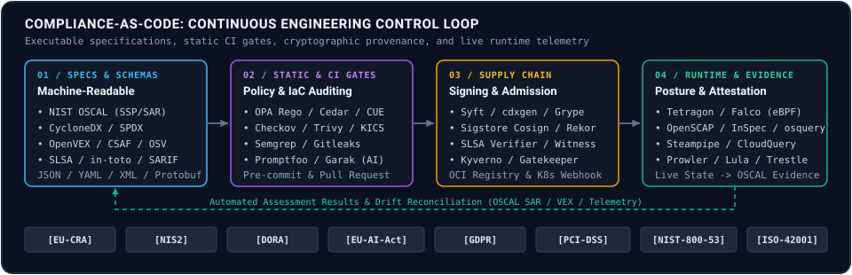

# Awesome Compliance-as-Code [](https://awesome.re)

A curated list of open-source Compliance-as-Code (CaC) specifications, policy engines, supply-chain verifiers, runtime auditors, and regulatory-to-code mappings for automating technical compliance across CI/CD pipelines and production infrastructure.

Compliance-as-Code translates statutory regulations, security baselines, and industry standards into machine-readable specifications, declarative policies, and automated verification gates. If a requirement cannot be validated via CLI, queried via API, or enforced in a deployment pipeline, it does not belong in this catalog.



## Contents

- [1. Machine-Readable Formats & Data Protocols](#1-machine-readable-formats--data-protocols)
  - [Control & Assessment Schemas](#control--assessment-schemas)
  - [Software Bill of Materials (SBOM, CBOM, SaaSBOM, HBOM)](#software-bill-of-materials-sbom-cbom-saasbom-hbom)
  - [Vulnerability, Advisory & Exploitability Formats](#vulnerability-advisory--exploitability-formats)
  - [Provenance & Attestation Specifications](#provenance--attestation-specifications)
- [2. Policy-as-Code (PaC) Engines & Domain Languages](#2-policy-as-code-pac-engines--domain-languages)
  - [General-Purpose Policy & Constraint Engines](#general-purpose-policy--constraint-engines)
  - [Kubernetes Admission & Policy Controllers](#kubernetes-admission--policy-controllers)
  - [Fine-Grained Authorization & Access Control Engines](#fine-grained-authorization--access-control-engines)
- [3. Infrastructure-as-Code (IaC) & Static Config Auditing](#3-infrastructure-as-code-iac--static-config-auditing)
  - [Multi-Cloud & Terraform Scanners](#multi-cloud--terraform-scanners)
  - [Kubernetes Manifest, Helm & Container Linters](#kubernetes-manifest-helm--container-linters)
  - [Source Code, Secrets & Privacy Static Analyzers](#source-code-secrets--privacy-static-analyzers)
- [4. Software Supply Chain & Artifact Integrity](#4-software-supply-chain--artifact-integrity)
  - [SBOM Generation & Manipulation](#sbom-generation--manipulation)
  - [Vulnerability Correlation & VEX Tooling](#vulnerability-correlation--vex-tooling)
  - [Cryptographic Signing, Provenance & Transparency Logs](#cryptographic-signing-provenance--transparency-logs)
  - [License Compliance & Dependency Governance](#license-compliance--dependency-governance)
  - [Supply-Chain Graph & Policy Aggregators](#supply-chain-graph--policy-aggregators)
- [5. Host, Kernel & Runtime Hardening](#5-host-kernel--runtime-hardening)
  - [SCAP, CIS & STIG Host Auditing](#scap-cis--stig-host-auditing)
  - [Kubernetes Node & Cluster Runtime Benchmarks](#kubernetes-node--cluster-runtime-benchmarks)
  - [eBPF & Kernel Runtime Policy Enforcement](#ebpf--kernel-runtime-policy-enforcement)
  - [Fleet Telemetry, Cryptography & Log Integrity](#fleet-telemetry-cryptography--log-integrity)
- [6. Automated Evidence Gathering & Cloud Posture](#6-automated-evidence-gathering--cloud-posture)
  - [SQL-Over-Infrastructure & Asset Graph Engines](#sql-over-infrastructure--asset-graph-engines)
  - [Continuous Cloud Security Posture & Drift Engines](#continuous-cloud-security-posture--drift-engines)
  - [OSCAL Automation & Evidence-as-Code Frameworks](#oscal-automation--evidence-as-code-frameworks)
- [7. AI/ML Compliance & Model Governance](#7-aiml-compliance--model-governance)
  - [LLM Red-Teaming, Guardrails & Safety Gates](#llm-red-teaming-guardrails--safety-gates)
  - [RAG Faithfulness, Hallucination & Benchmark Evaluation](#rag-faithfulness-hallucination--benchmark-evaluation)
  - [Algorithmic Fairness, Differential Privacy & Artifact Integrity](#algorithmic-fairness-differential-privacy--artifact-integrity)
- [8. Pre-Built Policy Packs & Mappings](#8-pre-built-policy-packs--mappings)
  - [Machine-Readable Control Catalogs & Requirements](#machine-readable-control-catalogs--requirements)
  - [Kubernetes, OPA & Kyverno Policy Libraries](#kubernetes-opa--kyverno-policy-libraries)
  - [Host, Edge & Cloud Hardening Baselines](#host-edge--cloud-hardening-baselines)
- [9. Educational & Reference Architectures](#9-educational--reference-architectures)
  - [Supply-Chain & Open-Source Security Frameworks](#supply-chain--open-source-security-frameworks)
  - [Cloud, GitOps & AI Governance Blueprints](#cloud-gitops--ai-governance-blueprints)
- [Regulatory-to-Code Mapping Matrix](#regulatory-to-code-mapping-matrix)
- [Reference Implementations](#reference-implementations)
- [Contributing](#contributing)
- [License](#license)

## 1. Machine-Readable Formats & Data Protocols

Serializable schemas (JSON, YAML, XML, Protobuf) that replace ambiguous natural-language compliance requirements with deterministic data structures.

### Control & Assessment Schemas

- [AsyncAPI Specification](https://github.com/asyncapi/spec) - Linux Foundation open standard for defining message-driven APIs, event payloads, and security authentication schemas in YAML and JSON. `[Multi-Framework]` `[DORA]` `Apache-2.0`
- [CloudEvents Specification](https://github.com/cloudevents/spec) - CNCF specification for describing event data in a common, interoperable format across security telemetry and compliance automation pipelines. `[DORA]` `[Multi-Framework]` `Apache-2.0`
- [Common Cloud Controls (FINOS CCC)](https://github.com/finos/common-cloud-controls) - Open standard maintained by FINOS describing consistent cyber, operational, and resiliency controls for financial-sector cloud deployments. `[DORA]` `[SOC2/ISO27001]` `Community-Spec-1.0`
- [Gemara (OpenSSF GRC Schema)](https://github.com/gemaraproj/gemara) - OpenSSF data model and YAML schema framework for expressing Layer 1-4 security guidance, control catalogs, policy rules, and automated compliance evaluation logs. `[Multi-Framework]` `[EU-CRA]` `Apache-2.0`
- [JSON Schema Specification](https://github.com/json-schema-org/json-schema-spec) - Canonical vocabulary specification for annotating, constraining, and validating structured JSON documents across compliance pipelines. `[Multi-Framework]` `BSD-3-Clause`
- [JSON Schema Store](https://github.com/SchemaStore/schemastore) - Universal repository of machine-readable JSON Schema definitions used to validate CI/CD workflows, Kubernetes manifests, and security configuration files. `[Multi-Framework]` `Apache-2.0`
- [NIST Metaschema Framework](https://github.com/usnistgov/metaschema) - Schema modeling framework developed by NIST that generates synchronized XML, JSON, and YAML validation schemas backing the OSCAL ecosystem. `[NIST-800-53]` `[Multi-Framework]` `Public-Domain`
- [NIST OSCAL (Open Security Controls Assessment Language)](https://github.com/usnistgov/OSCAL) - Standardized XML, JSON, and YAML schemas developed by NIST for expressing control catalogs, baselines, System Security Plans (SSP), and assessment results. `[NIST-800-53]` `[Multi-Framework]` `Public-Domain`
- [OCI Distribution Specification](https://github.com/opencontainers/distribution-spec) - Open Container Initiative API standard for distributing container images, SBOMs, and cryptographic referrers across registries. `[EU-CRA]` `[SLSA]` `Apache-2.0`
- [OCI Image Specification](https://github.com/opencontainers/image-spec) - Open Container Initiative schema defining interoperable container image manifests, filesystem layers, and cryptographic configuration annotations. `[EU-CRA]` `[CIS]` `Apache-2.0`
- [OCI Runtime Specification](https://github.com/opencontainers/runtime-spec) - Open Container Initiative specification governing container execution state, Linux namespaces, cgroups, and seccomp security boundaries. `[CIS]` `[NIS2]` `Apache-2.0`
- [OCSF Schema (Open Cybersecurity Schema Framework)](https://github.com/ocsf/ocsf-schema) - Vendor-agnostic JSON event schema standardizing security telemetry, audit logs, and compliance posture findings across detection platforms. `[DORA]` `[NIS2]` `Apache-2.0`
- [OpenAPI Specification (OAS)](https://github.com/OAI/OpenAPI-Specification) - Linux Foundation standard defining language-agnostic REST API contracts, payload schemas, and OAuth2/mTLS security requirements. `[Multi-Framework]` `[PCI-DSS]` `Apache-2.0`
- [OpenSSF Security Insights Specification](https://github.com/ossf/security-insights) - Machine-readable YAML schema enabling software projects to publish verifiable attestations of their security governance, vulnerability reporting, and build controls. `[EU-CRA]` `[SLSA]` `Community-Spec-1.0`
- [OpenTelemetry Protocol (OTLP) Specification](https://github.com/open-telemetry/opentelemetry-proto) - Canonical Protocol Buffer schema definitions for transporting traces, metrics, and immutable security audit logs across distributed systems. `[DORA]` `[SOC2/ISO27001]` `Apache-2.0`
- [OpenTelemetry Semantic Conventions](https://github.com/open-telemetry/semantic-conventions) - Standardized attribute naming and schema definitions for logs, traces, and audit events across distributed systems. `[DORA]` `[SOC2/ISO27001]` `Apache-2.0`
- [OpenTelemetry Specification](https://github.com/open-telemetry/opentelemetry-specification) - Cross-language architectural specification governing OpenTelemetry traces, metrics, logs, and immutable audit telemetry SDKs. `[DORA]` `[SOC2/ISO27001]` `Apache-2.0`
- [SPIFFE Specification](https://github.com/spiffe/spiffe) - CNCF open standard defining cryptographic workload identities (SVIDs), trust domains, and short-lived X.509/JWT federation APIs for zero-trust infrastructure. `[DORA]` `[NIST-800-53]` `Apache-2.0`
- [TAXII 2.1 Specification (OASIS CTI)](https://github.com/oasis-tcs/cti-taxii2) - OASIS RESTful API and transport specification for exchanging structured cyber threat intelligence and STIX 2.1 indicator collections. `[NIS2]` `[DORA]` `BSD-3-Clause`

### Software Bill of Materials (SBOM, CBOM, SaaSBOM, HBOM)

- [Croissant ML Dataset Metadata Format](https://github.com/mlcommons/croissant) - MLCommons JSON-LD metadata specification for describing machine learning datasets, lineage, and licensing under EU AI Act data governance rules. `[EU-AI-Act]` `[ISO-42001]` `Apache-2.0`
- [CycloneDX Property Taxonomy](https://github.com/CycloneDX/cyclonedx-property-taxonomy) - Official namespace and property taxonomy extending CycloneDX SBOMs with standardized security, AI, and cryptographic metadata fields. `[EU-CRA]` `[NIS2]` `Apache-2.0`
- [CycloneDX Specification](https://github.com/CycloneDX/specification) - OWASP standard for Software, Hardware, Cryptography, and SaaS Bills of Materials (SBOM, HBOM, CBOM, SaaSBOM) with formal vulnerability and compliance attestations. `[EU-CRA]` `[NIS2]` `Apache-2.0`
- [CycloneDX Transparency Exchange API (TEA)](https://github.com/CycloneDX/transparency-exchange-api) - Standard REST API specification for automated discovery and exchange of SBOM, CBOM, VEX, and compliance attestations across supply-chain participants. `[EU-CRA]` `[NIS2]` `Apache-2.0`
- [OmniBOR Specification](https://github.com/omnibor/spec) - Minimalist artifact identity specification constructing reproducible content-addressable dependency graphs across software build trees. `[EU-CRA]` `[SLSA]` `Community-Spec-1.0`
- [Package URL (purl) Specification](https://github.com/package-url/purl-spec) - Universal, URI-based identifier standard for referencing software packages reliably across package managers, SBOM formats, and vulnerability databases. `[EU-CRA]` `[Multi-Framework]` `MIT`
- [packageurl-go](https://github.com/package-url/packageurl-go) - Official Go parser, canonicalizer, and builder implementation of the Package URL (`purl`) specification for SBOM and vulnerability tools. `[EU-CRA]` `[Multi-Framework]` `MIT`
- [SPDX (Software Package Data Exchange)](https://github.com/spdx/spdx-spec) - ISO/IEC 5962:2021 open standard for communicating software bill of materials components, licenses, copyrights, and security references. `[EU-CRA]` `[NIS2]` `Community-Spec-1.0`
- [SPDX 3.0 Model](https://github.com/spdx/spdx-3-model) - Next-iteration domain model for the SPDX standard introducing dedicated profiles for software, AI datasets, build provenance, and licensing. `[EU-CRA]` `[EU-AI-Act]` `Community-Spec-1.0`
- [SPDX License List Data](https://github.com/spdx/license-list-data) - Machine-readable JSON, RDF, and text distributions of the canonical SPDX License List and standard license exceptions. `[EU-CRA]` `[Multi-Framework]` `CC0-1.0`
- [SPDX License List XML](https://github.com/spdx/license-list-XML) - Canonical XML dataset of open-source licenses and exceptions backing SPDX license identifiers across compliance scanners. `[EU-CRA]` `[Multi-Framework]` `CC0-1.0`
- [SPDX Specification Examples](https://github.com/spdx/spdx-examples) - Official reference collection of validated SPDX SBOM documents in JSON, YAML, XML, and tag-value formats for conformance testing. `[EU-CRA]` `[NIS2]` `GPL-3.0`
- [Version Range Specification (vers)](https://github.com/package-url/vers-spec) - Universal URI-based syntax specification for expressing software package version ranges consistently across vulnerability advisories and SBOMs. `[EU-CRA]` `[Multi-Framework]` `MIT`

### Vulnerability, Advisory & Exploitability Formats

- [CISA Known Exploited Vulnerabilities (KEV) Catalog](https://github.com/cisagov/kev-data) - Machine-readable JSON and CSV feed maintained by CISA cataloging vulnerabilities actively exploited in the wild for mandatory remediation prioritization. `[EU-CRA]` `[NIS2]` `CC0-1.0`
- [CISA Vulnrichment](https://github.com/cisagov/vulnrichment) - Machine-readable CVE v5 repository maintained by CISA enriching vulnerability records with SSVC decision trees, CVSS vectors, and CWE mappings. `[EU-CRA]` `[NIS2]` `CC0-1.0`
- [CSAF (Common Security Advisory Framework)](https://github.com/oasis-tcs/csaf) - OASIS standard for publishing and consuming machine-readable security advisories and vulnerability disclosures across software supply chains. `[EU-CRA]` `[NIS2]` `BSD-3-Clause`
- [CSAF Go Tools (gocsaf)](https://github.com/gocsaf/csaf) - Go CLI suite developed with the German Federal Office for Information Security (BSI) for aggregating, verifying, and distributing OASIS CSAF 2.0 security advisories. `[EU-CRA]` `[NIS2]` `Apache-2.0`
- [CVE JSON Record Format Schema](https://github.com/CVEProject/cve-schema) - Official JSON Schema specification for Common Vulnerabilities and Exposures (CVE) v5 records, CVSS vectors, and CWE problem types. `[EU-CRA]` `[NIS2]` `CC0-1.0`
- [GitHub Security Advisory Database](https://github.com/github/advisory-database) - Open-source OSV-formatted vulnerability database covering npm, PyPI, Go, Rust, Maven, NuGet, Composer, and RubyGems ecosystems. `[EU-CRA]` `[NIS2]` `CC-BY-4.0`
- [Go Vulnerability Database (vulndb)](https://github.com/golang/vulndb) - Official Go security advisory database publishing OSV-formatted vulnerability reports with symbol-level call-stack metadata. `[EU-CRA]` `[NIS2]` `BSD-3-Clause`
- [OpenSSF Malicious Packages OSV Dataset](https://github.com/ossf/malicious-packages) - Curated collection of Open Source Vulnerability (OSV) reports tracking confirmed malicious packages across npm, PyPI, RubyGems, and Crates.io. `[EU-CRA]` `[NIS2]` `Apache-2.0`
- [OpenVEX](https://github.com/openvex/spec) - Minimal, interoperable Vulnerability Exploitability eXchange specification for attesting whether a vulnerability listed in an SBOM is exploitable in practice. `[EU-CRA]` `[NIS2]` `CC0-1.0`
- [OSV Schema (Open Source Vulnerability)](https://github.com/ossf/osv-schema) - OpenSSF JSON schema for describing vulnerabilities precisely across open-source ecosystems and commit ranges. `[EU-CRA]` `[NIS2]` `Apache-2.0`
- [Python Packaging Advisory Database](https://github.com/pypa/advisory-database) - Canonical repository of OSV-formatted security advisories for Python packages published on PyPI. `[EU-CRA]` `[NIS2]` `CC-BY-4.0`
- [SARIF (Static Analysis Results Interchange Format)](https://github.com/oasis-tcs/sarif-spec) - OASIS JSON standard unifying the output of static analysis and compliance scanners across CI/CD systems. `[Multi-Framework]` `BSD-3-Clause`
- [Secvisogram](https://github.com/secvisogram/secvisogram) - OASIS CSAF 2.0 reference editor and JSON Schema validator for authoring and signing machine-readable security advisories. `[EU-CRA]` `[NIS2]` `MIT`
- [STIX 2.1 Specification (OASIS CTI)](https://github.com/oasis-tcs/cti-stix2) - Structured Threat Information Expression JSON schema for exchanging cyber threat intelligence and vulnerability indicators. `[NIS2]` `[DORA]` `BSD-3-Clause`

### Provenance & Attestation Specifications

- [C2PA Technical Specifications](https://github.com/c2pa-org/specifications) - Coalition for Content Provenance and Authenticity open standard for binding cryptographic provenance manifests to digital media and AI-generated outputs. `[EU-AI-Act]` `[SLSA]` `CC-BY-4.0`
- [CoRIM (Concise Reference Integrity Manifest)](https://github.com/veraison/corim) - Go library implementing the IETF RATS Concise Reference Integrity Manifest specification for hardware, firmware, and TEE cryptographic measurements. `[EU-CRA]` `[SLSA]` `Apache-2.0`
- [DSSE (Dead Simple Signing Envelope)](https://github.com/secure-systems-lab/dsse) - Cryptographic signature envelope specification designed to sign arbitrary supply-chain metadata and in-toto predicates without canonicalization bugs. `[SLSA]` `[EU-CRA]` `Apache-2.0`
- [EAR (EAT Attestation Results)](https://github.com/veraison/ear) - Go implementation of the IETF RATS Attestation Results for Secure Interactions (AR4SI) token format over CBOR and JSON. `[EU-CRA]` `[SLSA]` `Apache-2.0`
- [IETF SCITT Architecture](https://github.com/ietf-wg-scitt/draft-ietf-scitt-architecture) - IETF Supply Chain Integrity, Transparency, and Trust working group specification for append-only transparency services and signed receipts. `[EU-CRA]` `[SLSA]` `BSD-2-Clause`
- [in-toto Attestation Framework](https://github.com/in-toto/attestation) - Vendor-neutral specifications and schemas for cryptographically verifiable software supply-chain step metadata and predicates. `[EU-CRA]` `[SLSA]` `Apache-2.0`
- [Notary Project Specifications](https://github.com/notaryproject/specifications) - Open standard defining X.509 and COSE cryptographic signature envelopes, trust stores, and verification policies for OCI registry artifacts. `[EU-CRA]` `[SLSA]` `Apache-2.0`
- [Sigstore Protobuf Specs](https://github.com/sigstore/protobuf-specs) - Protocol Buffer and JSON schema definitions for Sigstore cryptographic bundles, verification material, and transparency log entries. `[EU-CRA]` `[SLSA]` `Apache-2.0`
- [SLSA (Supply-chain Levels for Software Artifacts)](https://github.com/slsa-framework/slsa) - Security framework and provenance specification defining verifiable build integrity levels for software artifacts. `[SLSA]` `[EU-CRA]` `Community-Spec-1.0`
- [TUF (The Update Framework) Specification](https://github.com/theupdateframework/specification) - CNCF specification designing compromise-resilient software repository metadata, threshold signatures, and role delegations. `[EU-CRA]` `[SLSA]` `Community-Spec-1.0`
- [Uptane Standard](https://github.com/uptane/uptane-standard) - Compromise-resilient software update security framework designed for automotive, embedded, and IoT systems subject to statutory safety rules. `[EU-CRA]` `[NIS2]` `Community-Spec-1.0`

## 2. Policy-as-Code (PaC) Engines & Domain Languages

Evaluation engines that process structured inputs (ASTs, JSON, admission requests, infrastructure plans) and emit deterministic allow/deny decisions.

### General-Purpose Policy & Constraint Engines

- [Buf CLI](https://github.com/bufbuild/buf) - Protocol Buffer schema linter and breaking-change detector enforcing API contract invariants and wire-format compatibility in CI pipelines. `[Multi-Framework]` `[DORA]` `Apache-2.0`
- [Cedar](https://github.com/cedar-policy/cedar) - Formally verified policy language and evaluation engine developed for fine-grained permissions and automated mathematical reasoning over authorization policies. `[NIST-800-53]` `[SOC2/ISO27001]` `Apache-2.0`
- [Cedar Formal Specification](https://github.com/cedar-policy/cedar-spec) - Formal mathematical models and Lean verification proofs guaranteeing soundness and safety of the Cedar policy evaluation engine. `[NIST-800-53]` `[SOC2/ISO27001]` `Apache-2.0`
- [cedar-go](https://github.com/cedar-policy/cedar-go) - Native Go implementation of the Cedar policy evaluation engine for embedding fine-grained authorization checks into cloud-native services. `[NIST-800-53]` `[SOC2/ISO27001]` `Apache-2.0`
- [cedar-java](https://github.com/cedar-policy/cedar-java) - Official Java bindings and JVM integration library for the formally verified Cedar authorization policy engine. `[NIST-800-53]` `[SOC2/ISO27001]` `Apache-2.0`
- [CEL (Common Expression Language) Spec](https://github.com/cel-expr/cel-spec) - Non-Turing-complete expression language specification designed for fast, safe, embedded policy evaluation inside Kubernetes and RPC gateways. `[Multi-Framework]` `Apache-2.0`
- [cel-go](https://github.com/cel-expr/cel-go) - Reference Go implementation of the Common Expression Language for evaluating linear-time compliance and admission expressions. `[Multi-Framework]` `Apache-2.0`
- [cel-rust](https://github.com/cel-rust/cel-rust) - Native Rust interpreter for the Common Expression Language (CEL) enabling memory-safe, linear-time policy evaluation in Rust services. `[Multi-Framework]` `MIT`
- [Crossplane](https://github.com/crossplane/crossplane) - CNCF cloud-native control plane framework that enforces declarative infrastructure compositions, drift reconciliation, and validation schemas via Kubernetes CRDs. `[DORA]` `[NIS2]` `Apache-2.0`
- [CUE](https://github.com/cue-lang/cue) - Strongly typed constraint and data validation language based on lattice logic for unifying schemas, configurations, and compliance rules. `[Multi-Framework]` `Apache-2.0`
- [cvc5](https://github.com/cvc5/cvc5) - Automated theorem prover and Satisfiability Modulo Theories (SMT) solver used to mathematically verify cloud IAM policies and Cedar invariants. `[NIST-800-53]` `[Multi-Framework]` `BSD-3-Clause`
- [Dhall Configuration Language](https://github.com/dhall-lang/dhall-haskell) - Programmable, non-Turing-complete configuration language with static types and guaranteed termination for generating verified infrastructure policies. `[Multi-Framework]` `BSD-3-Clause`
- [Jsonnet](https://github.com/google/jsonnet) - Hermetic data-templating and constraint language for synthesizing deterministic JSON, YAML, and Kubernetes configuration manifests. `[Multi-Framework]` `Apache-2.0`
- [KCL (Kubernetes Configuration Language)](https://github.com/kcl-lang/kcl) - CNCF constraint-based record and functional language designed for validating cloud-native configurations and policy schemas in CI. `[Multi-Framework]` `[CIS]` `Apache-2.0`
- [Nickel](https://github.com/nickel-lang/nickel) - Configuration and policy language with gradual typing and contract verification for generating validated infrastructure manifests. `[Multi-Framework]` `MIT`
- [Open Policy Agent (OPA)](https://github.com/open-policy-agent/opa) - General-purpose policy engine using the declarative Rego language to decouple policy evaluation from application and infrastructure services. `[Multi-Framework]` `Apache-2.0`
- [Pkl](https://github.com/apple/pkl) - Configuration-as-code language with rich type and constraint validation capable of rendering verified JSON, YAML, XML, and property files. `[Multi-Framework]` `Apache-2.0`
- [Protovalidate](https://github.com/bufbuild/protovalidate) - Protocol Buffer validation library powered by Common Expression Language (CEL) constraints for enforcing schema invariants at RPC boundaries. `[Multi-Framework]` `Apache-2.0`
- [Regal](https://github.com/open-policy-agent/regal) - Linter and language server for Open Policy Agent Rego policies that enforces correctness, performance, and style rules across policy repositories. `[Multi-Framework]` `Apache-2.0`
- [Regorus](https://github.com/microsoft/regorus) - Fast, lightweight Rust implementation of the Open Policy Agent Rego evaluation engine suitable for embedded and WebAssembly environments. `[Multi-Framework]` `MIT`
- [Starlark-Go](https://github.com/google/starlark-go) - Go interpreter for the hermetic, deterministic Starlark configuration dialect used to embed side-effect-free policy evaluation in build and CI systems. `[Multi-Framework]` `BSD-3-Clause`
- [Wasmtime](https://github.com/bytecodealliance/wasmtime) - Bytecode Alliance WebAssembly runtime with capability-based WASI sandboxing used to execute isolated OPA and Kubewarden compliance policies. `[Multi-Framework]` `[EU-CRA]` `Apache-2.0`
- [Z3 Theorem Prover](https://github.com/Z3Prover/z3) - High-performance SMT constraint solver developed by Microsoft Research for formal verification of network reachability and access control policies. `[NIST-800-53]` `[Multi-Framework]` `MIT`

### Kubernetes Admission & Policy Controllers

- [Capsule](https://github.com/projectcapsule/capsule) - Kubernetes multi-tenancy and policy operator that enforces namespace isolation, resource quotas, ingress hostnames, and container registry allowlists. `[NIS2]` `[CIS]` `Apache-2.0`
- [cert-manager csi-driver](https://github.com/cert-manager/csi-driver) - Container Storage Interface (CSI) driver for cert-manager that provisions short-lived X.509 mTLS workload certificates directly into pod filesystems. `[DORA]` `[NIS2]` `Apache-2.0`
- [Chainsaw](https://github.com/kyverno/chainsaw) - Declarative end-to-end testing tool for Kubernetes operators and admission controllers to verify that compliance policies reject non-conformant workloads. `[NIS2]` `[DORA]` `Apache-2.0`
- [Connaisseur](https://github.com/sse-secure-systems/connaisseur) - Kubernetes mutating admission controller that verifies container image signatures and Cosign/Notary attestations before pinning digests at deployment. `[EU-CRA]` `[SLSA]` `Apache-2.0`
- [Fairwinds Gemini](https://github.com/FairwindsOps/gemini) - Kubernetes operator that automates VolumeSnapshot creation and retention schedules to enforce disaster-recovery backup policies. `[DORA]` `[SOC2/ISO27001]` `Apache-2.0`
- [Gatekeeper (OPA)](https://github.com/open-policy-agent/gatekeeper) - Customizable Kubernetes admission webhook and audit controller that enforces CRD-based OPA policies across clusters. `[NIS2]` `[DORA]` `Apache-2.0`
- [kube-mgmt](https://github.com/open-policy-agent/kube-mgmt) - Sidecar controller that synchronizes Kubernetes ConfigMaps and cluster resources into Open Policy Agent instances for policy evaluation. `[NIS2]` `[CIS]` `Apache-2.0`
- [Kubewarden Admission Controller](https://github.com/kubewarden/adm-controller) - Kubernetes policy controller that manages and executes WebAssembly (Wasm) admission policies written in Rust, Go, Rego, or CEL. `[NIS2]` `[CIS]` `Apache-2.0`
- [Kyverno](https://github.com/kyverno/kyverno) - Cloud-native policy engine designed for Kubernetes that validates, mutates, generates, and verifies resource configurations and image signatures using declarative YAML. `[NIS2]` `[DORA]` `Apache-2.0`
- [OPA Constraint Framework](https://github.com/open-policy-agent/frameworks) - Library backing OPA Gatekeeper that implements extensible ConstraintTemplates and CRD-driven policy evaluation. `[NIS2]` `[DORA]` `Apache-2.0`
- [OPA Envoy Plugin](https://github.com/open-policy-agent/opa-envoy-plugin) - Envoy External Authorization (`ext_authz`) gRPC plugin built on Open Policy Agent for enforcing L7 API access and mTLS policies across service meshes. `[NIS2]` `[DORA]` `Apache-2.0`
- [Pepr](https://github.com/defenseunicorns/pepr) - TypeScript Kubernetes controller framework for authoring strongly typed admission validation, mutation, and continuous runtime compliance policies. `[NIST-800-53]` `[CIS]` `Apache-2.0`
- [Policy Reporter (Kyverno)](https://github.com/kyverno/policy-reporter) - Observability and reporting toolkit that aggregates Kubernetes `PolicyReport` CRDs from Kyverno, Trivy, and Falco into Prometheus metrics and audit dashboards. `[NIS2]` `[DORA]` `MIT`
- [Ratify (Notary Project)](https://github.com/notaryproject/ratify) - Kubernetes admission verification engine that validates container signatures, SBOMs, and vulnerability reports prior to pod admission. `[EU-CRA]` `[SLSA]` `Apache-2.0`
- [Sigstore Policy Controller](https://github.com/sigstore/policy-controller) - Kubernetes admission controller that enforces Cosign container image signatures, Fulcio identities, and attested SBOM policies before pod scheduling. `[EU-CRA]` `[SLSA]` `Apache-2.0`

### Fine-Grained Authorization & Access Control Engines

- [Apache Casbin](https://github.com/apache/casbin) - Authorization library supporting ACL, RBAC, ABAC, and ReBAC access control models across Go, Python, Java, Rust, and Node.js. `[NIST-800-53]` `[SOC2/ISO27001]` `Apache-2.0`
- [Apache Ranger](https://github.com/apache/ranger) - Centralized security framework for defining, administering, and auditing fine-grained data access policies across Hadoop, SQL, and lakehouse platforms. `[GDPR]` `[DORA]` `Apache-2.0`
- [Authelia](https://github.com/authelia/authelia) - Open-source authentication and authorization server providing OpenID Connect 1.0, WebAuthn MFA, and declarative per-resource access control policies. `[NIS2]` `[SOC2/ISO27001]` `Apache-2.0`
- [Casbin-RS](https://github.com/apache/casbin-rs) - Native Rust implementation of the Apache Casbin authorization library supporting ACL, RBAC, and ABAC access control models with minimal memory overhead. `[NIST-800-53]` `[SOC2/ISO27001]` `Apache-2.0`
- [Cerbos](https://github.com/cerbos/cerbos) - Stateless, cloud-native access control decision engine that evaluates context-aware YAML authorization policies via gRPC and REST APIs. `[SOC2/ISO27001]` `[NIST-800-53]` `Apache-2.0`
- [jCasbin](https://github.com/apache/casbin-jcasbin) - Official Java authorization library for Apache Casbin supporting ACL, RBAC, and ABAC access control enforcement across JVM services. `[NIST-800-53]` `[SOC2/ISO27001]` `Apache-2.0`
- [node-casbin](https://github.com/apache/casbin-node-casbin) - Official Node.js and TypeScript authorization library implementing Apache Casbin RBAC, ABAC, and ReBAC policy evaluation. `[NIST-800-53]` `[SOC2/ISO27001]` `Apache-2.0`
- [OAuth2 Proxy](https://github.com/oauth2-proxy/oauth2-proxy) - Identity-aware reverse proxy that authenticates HTTP requests against OIDC Providers and enforces group, role, and email-domain access rules. `[NIS2]` `[SOC2/ISO27001]` `MIT`
- [OPAL (Open Policy Administration Layer)](https://github.com/permitio/opal) - Event-driven administration layer for Open Policy Agent and Cedar that synchronizes real-time policy and authorization data updates to edge engines. `[SOC2/ISO27001]` `[Multi-Framework]` `Apache-2.0`
- [OpenFGA](https://github.com/openfga/openfga) - Relationship-based access control (ReBAC) and authorization engine inspired by Google Zanzibar with auditable authorization modeling. `[SOC2/ISO27001]` `[NIST-800-53]` `Apache-2.0`
- [OpenFGA CLI](https://github.com/openfga/cli) - Command-line interface for validating, testing, and running declarative unit assertions against OpenFGA relationship-based authorization models in CI. `[SOC2/ISO27001]` `[NIST-800-53]` `Apache-2.0`
- [OpenFGA Language & Parser](https://github.com/openfga/language) - Multi-language parser and schema validator for transforming OpenFGA authorization DSL models into auditable JSON syntax trees. `[SOC2/ISO27001]` `[NIST-800-53]` `Apache-2.0`
- [Ory Hydra](https://github.com/ory/hydra) - Cloud-native OAuth 2.0 and OpenID Connect server certified by the OpenID Foundation for issuing cryptographic access tokens. `[NIS2]` `[PCI-DSS]` `Apache-2.0`
- [Ory Keto](https://github.com/ory/keto) - Open-source implementation of Google Zanzibar providing gRPC and REST APIs for relationship-based access control and permission checks. `[SOC2/ISO27001]` `[NIST-800-53]` `Apache-2.0`
- [Ory Kratos](https://github.com/ory/kratos) - Headless cloud-native identity and user management engine enforcing JSON Schema identity traits, passkeys, and MFA flows. `[NIS2]` `[GDPR]` `Apache-2.0`
- [Ory Oathkeeper](https://github.com/ory/oathkeeper) - Cloud-native Identity and Access Proxy (IAP) that authenticates, authorizes, and mutates incoming HTTP traffic using declarative rules. `[NIS2]` `[DORA]` `Apache-2.0`
- [Permify](https://github.com/Permify/permify) - Zanzibar-inspired authorization service with a domain-specific schema language for modeling RBAC, ABAC, and ReBAC permissions. `[SOC2/ISO27001]` `[NIST-800-53]` `AGPL-3.0`
- [Pomerium](https://github.com/pomerium/pomerium) - CNCF identity-aware zero-trust access proxy that enforces continuous per-request authentication and Policy Language authorization checks. `[NIS2]` `[DORA]` `Apache-2.0`
- [PyCasbin](https://github.com/apache/casbin-pycasbin) - Official Python authorization library implementing Apache Casbin ACL, RBAC, and ABAC policy enforcement for web APIs and data services. `[NIST-800-53]` `[SOC2/ISO27001]` `Apache-2.0`
- [SpiceDB](https://github.com/authzed/spicedb) - Open-source, Zanzibar-inspired database and policy engine for storing and evaluating fine-grained permissions across distributed applications. `[SOC2/ISO27001]` `[NIST-800-53]` `Apache-2.0`
- [Topaz](https://github.com/aserto-dev/topaz) - Fine-grained authorization service combining Open Policy Agent policy evaluation with a Zanzibar directory graph. `[SOC2/ISO27001]` `[NIST-800-53]` `Apache-2.0`
- [zed (AuthZed CLI)](https://github.com/authzed/zed) - Official command-line client for validating SpiceDB permission schemas, running relationship assertions, and auditing access graphs in CI. `[SOC2/ISO27001]` `[NIST-800-53]` `Apache-2.0`

## 3. Infrastructure-as-Code (IaC) & Static Config Auditing

Static analyzers that inspect declarative infrastructure templates, container manifests, and source code before provisioning.

### Multi-Cloud & Terraform Scanners

- [Atlantis](https://github.com/runatlantis/atlantis) - Self-hosted Terraform and OpenTofu pull-request automation server that enforces Conftest/OPA policy gates and peer-approval workflows before apply. `[DORA]` `[SOC2/ISO27001]` `Apache-2.0`
- [Azure Bicep](https://github.com/Azure/bicep) - Domain-specific Infrastructure-as-Code language for Azure featuring a built-in static linter that checks resource templates against security rules. `[CIS]` `[DORA]` `MIT`
- [Burrito](https://github.com/padok-team/burrito) - Kubernetes GitOps operator for Terraform and OpenTofu that continuously detects infrastructure drift and reconciles cloud state against Git repositories. `[DORA]` `[SOC2/ISO27001]` `Apache-2.0`
- [cfn-lint (CloudFormation Linter)](https://github.com/aws-cloudformation/cfn-lint) - Static validator for AWS CloudFormation JSON and YAML templates checking resource properties against the AWS specification and custom policy rules. `[CIS]` `[SOC2/ISO27001]` `MIT-0`
- [Checkov](https://github.com/bridgecrewio/checkov) - Graph-based static analysis scanner for Terraform, OpenTofu, CloudFormation, Kubernetes, Helm, and Bicep with built-in CIS and regulatory control mappings. `[CIS]` `[SOC2/ISO27001]` `Apache-2.0`
- [CloudFormation Guard (cfn-guard)](https://github.com/aws-cloudformation/cloudformation-guard) - Rust-based Policy-as-Code DSL and CLI validator for checking CloudFormation templates, Terraform JSON plans, and Kubernetes manifests against compliance rules. `[CIS]` `[NIST-800-53]` `Apache-2.0`
- [Digger](https://github.com/diggerhq/digger) - Open-source CI/CD orchestrator for Terraform and OpenTofu supporting Open Policy Agent plan validation, drift detection, and RBAC. `[DORA]` `[SOC2/ISO27001]` `MIT`
- [Infracost](https://github.com/infracost/infracost) - CI/CD scanner for Terraform that evaluates cloud cost guardrails, tagging policies, and FinOps governance rules on pull requests. `[DORA]` `[Multi-Framework]` `Apache-2.0`
- [KICS (Keeping Infrastructure as Code Secure)](https://github.com/Checkmarx/kics) - Open-source static scanner powered by OPA Rego queries to detect security misconfigurations across IaC providers. `[CIS]` `[NIST-800-53]` `Apache-2.0`
- [OpenTofu](https://github.com/opentofu/opentofu) - Linux Foundation open-source Infrastructure-as-Code engine featuring native client-side state file encryption and continuous `check` assertion blocks. `[DORA]` `[NIS2]` `MPL-2.0`
- [pre-commit-terraform](https://github.com/antonbabenko/pre-commit-terraform) - Collection of Git pre-commit hooks integrating Checkov, Trivy, TFLint, and Terraform validate before code is committed. `[CIS]` `[Multi-Framework]` `MIT`
- [terraform-compliance](https://github.com/terraform-compliance/cli) - Behavior-Driven Development (BDD) security and compliance test framework that validates Terraform execution plans against human-readable policy scenarios. `[CIS]` `[SOC2/ISO27001]` `MIT`
- [terraform-docs](https://github.com/terraform-docs/terraform-docs) - Utility that generates automated input, output, and dependency documentation from Terraform modules in Markdown, JSON, and YAML formats. `[SOC2/ISO27001]` `[Multi-Framework]` `MIT`
- [Terragrunt](https://github.com/gruntwork-io/terragrunt) - Orchestration wrapper for OpenTofu and Terraform that enforces immutable remote state configurations, encryption defaults, and pre-execution policy hooks. `[DORA]` `[CIS]` `MIT`
- [Terramate](https://github.com/terramate-io/terramate) - IaC code generator and orchestration engine for Terraform and OpenTofu supporting stack drift detection and policy-gated CI workflows. `[DORA]` `[SOC2/ISO27001]` `MPL-2.0`
- [TFLint](https://github.com/terraform-linters/tflint) - Pluggable Terraform linter that enforces provider-specific validity rules, naming conventions, and deprecated resource checks in CI. `[CIS]` `[Multi-Framework]` `MPL-2.0`
- [tflint-ruleset-aws](https://github.com/terraform-linters/tflint-ruleset-aws) - Official AWS ruleset plugin for TFLint that validates IAM policy syntax, resource configurations, and deprecated instance types before plan execution. `[CIS]` `[SOC2/ISO27001]` `MPL-2.0`
- [tflint-ruleset-azurerm](https://github.com/terraform-linters/tflint-ruleset-azurerm) - Official Microsoft Azure ruleset plugin for TFLint checking Terraform HCL definitions against Azure API constraints and security parameters. `[CIS]` `[SOC2/ISO27001]` `MPL-2.0`
- [tflint-ruleset-google](https://github.com/terraform-linters/tflint-ruleset-google) - Official Google Cloud Platform ruleset plugin for TFLint enforcing valid GCP resource settings and IAM member formats in CI. `[CIS]` `[SOC2/ISO27001]` `MPL-2.0`
- [tfsec](https://github.com/aquasecurity/tfsec) - Static analysis security scanner for Terraform code that evaluates HCL templates locally and in CI pipelines against cloud security baselines. `[CIS]` `[SOC2/ISO27001]` `MIT`
- [Tofu Controller (Flux IaC)](https://github.com/flux-iac/tofu-controller) - Flux GitOps Kubernetes controller for OpenTofu and Terraform automating state drift detection and policy-gated plan approvals. `[DORA]` `[NIS2]` `Apache-2.0`
- [Trivy](https://github.com/aquasecurity/trivy) - Unified security scanner for container images, filesystems, Git repositories, IaC misconfigurations, Kubernetes clusters, and SBOM generation. `[EU-CRA]` `[NIS2]` `Apache-2.0`

### Kubernetes Manifest, Helm & Container Linters

- [Argo CD](https://github.com/argoproj/argo-cd) - CNCF declarative GitOps continuous delivery controller for Kubernetes that continuously detects live cluster drift against versioned Git manifests. `[DORA]` `[SOC2/ISO27001]` `Apache-2.0`
- [chart-testing (ct)](https://github.com/helm/chart-testing) - Official Helm CLI tool for linting, YAML schema validation, and automated kind/cluster installation testing of Helm charts in pull requests. `[CIS]` `[DORA]` `Apache-2.0`
- [Conftest](https://github.com/open-policy-agent/conftest) - CLI utility built on Open Policy Agent for writing unit tests against structured configuration files including Terraform, Kubernetes, and Dockerfiles. `[Multi-Framework]` `Apache-2.0`
- [Container Structure Test](https://github.com/GoogleContainerTools/container-structure-test) - CLI framework developed by Google to validate file permissions, package versions, metadata, and command outputs inside built container images. `[CIS]` `[EU-CRA]` `Apache-2.0`
- [crane (go-containerregistry)](https://github.com/google/go-containerregistry) - Go library and CLI suite (`crane`, `gcrane`) for inspecting OCI image manifests, verifying cryptographic digests, and mutating image layers without Docker. `[EU-CRA]` `[SLSA]` `Apache-2.0`
- [Dive](https://github.com/wagoodman/dive) - Container image layer analyzer and CI gate that inspects filesystem diffs per layer to detect leaked build secrets and bloated packages. `[EU-CRA]` `[CIS]` `MIT`
- [Dockle](https://github.com/goodwithtech/dockle) - Container image linter for security and compliance auditing that checks images against CIS Docker Benchmark controls. `[CIS]` `[NIS2]` `Apache-2.0`
- [Flux](https://github.com/fluxcd/flux2) - CNCF GitOps toolkit that reconciles Kubernetes clusters from Git and OCI repositories with built-in Cosign signature verification and SOPS decryption. `[DORA]` `[SLSA]` `Apache-2.0`
- [Goldilocks](https://github.com/FairwindsOps/goldilocks) - Kubernetes utility that audits workload resource requests and limits against VerticalPodAutoscaler baselines to support availability controls. `[DORA]` `[NIS2]` `Apache-2.0`
- [Hadolint](https://github.com/hadolint/hadolint) - Dockerfile linter written in Haskell that parses container build instructions into an AST and validates inline shell scripts via ShellCheck. `[CIS]` `[EU-CRA]` `GPL-3.0`
- [helm-docs](https://github.com/norwoodj/helm-docs) - Tool that parses Helm chart metadata and `values.yaml` comments to generate standardized Markdown configuration and security parameter tables. `[SOC2/ISO27001]` `[Multi-Framework]` `GPL-3.0`
- [helm-unittest](https://github.com/helm-unittest/helm-unittest) - BDD-style unit testing plugin for Helm that evaluates rendered Kubernetes templates against declarative security context and RBAC assertions offline. `[CIS]` `[NIS2]` `MIT`
- [kapp (Carvel)](https://github.com/carvel-dev/kapp) - CNCF Carvel Kubernetes deployment tool that calculates deterministic resource diffs and enforces explicit apply ordering rules in CI/CD. `[DORA]` `[CIS]` `Apache-2.0`
- [kbld (Carvel)](https://github.com/carvel-dev/kbld) - CNCF Carvel image resolution tool that rewrites mutable container image tags in Kubernetes manifests into immutable SHA-256 cryptographic digests. `[SLSA]` `[EU-CRA]` `Apache-2.0`
- [kube-capacity](https://github.com/robscott/kube-capacity) - CLI tool that audits CPU and memory resource requests, limits, and utilization across Kubernetes nodes and namespaces. `[DORA]` `[CIS]` `Apache-2.0`
- [Kube-linter](https://github.com/stackrox/kube-linter) - Static analysis CLI tool that checks Kubernetes YAML manifests and Helm charts against production security and privilege baselines. `[CIS]` `[NIS2]` `Apache-2.0`
- [kube-no-trouble (kubent)](https://github.com/doitintl/kube-no-trouble) - CLI tool that detects Kubernetes cluster resources using deprecated or removed API versions prior to control-plane upgrades. `[DORA]` `[NIS2]` `MIT`
- [Kube-score](https://github.com/zegl/kube-score) - Static code analysis tool for Kubernetes object definitions that evaluates network policies, security contexts, and pod disruption budgets. `[CIS]` `[DORA]` `MIT`
- [Kubeconform](https://github.com/yannh/kubeconform) - Fast Kubernetes manifest validator with support for Custom Resource Definitions (CRDs) and offline JSON schema verification in CI. `[Multi-Framework]` `Apache-2.0`
- [Kubescape](https://github.com/kubescape/kubescape) - Kubernetes security platform for scanning clusters, YAML manifests, and Helm charts against NSA-CISA, MITRE ATT&CK, CIS, and SOC 2 frameworks. `[CIS]` `[SOC2/ISO27001]` `Apache-2.0`
- [Kubesec](https://github.com/controlplaneio/kubesec) - Security risk analysis tool for Kubernetes resources that produces deterministic numeric scores for Pod specifications. `[CIS]` `[NIS2]` `Apache-2.0`
- [Kustomize](https://github.com/kubernetes-sigs/kustomize) - Kubernetes-native configuration management tool for applying template-free security overlays, namespace transformers, and resource patches. `[CIS]` `[Multi-Framework]` `Apache-2.0`
- [Nova](https://github.com/FairwindsOps/nova) - CLI scanner that inspects Kubernetes clusters for outdated or deprecated Helm charts and container images. `[NIS2]` `[DORA]` `Apache-2.0`
- [Pluto](https://github.com/FairwindsOps/pluto) - CLI utility that scans Kubernetes repositories, Helm releases, and live clusters for deprecated API versions. `[DORA]` `[NIS2]` `Apache-2.0`
- [Polaris](https://github.com/FairwindsOps/polaris) - Validation engine and dashboard for auditing Kubernetes workloads against security, reliability, and resource isolation rules. `[CIS]` `[SOC2/ISO27001]` `Apache-2.0`
- [Popeye](https://github.com/derailed/popeye) - Live Kubernetes cluster sanitizer that scans deployed resources and reports misconfigurations, dead ports, and RBAC over-permissions. `[CIS]` `[NIS2]` `Apache-2.0`
- [rbac-manager](https://github.com/FairwindsOps/rbac-manager) - Kubernetes operator that simplifies and audits RoleBindings and ServiceAccounts through declarative RBACDefinition custom resources. `[CIS]` `[NIST-800-53]` `Apache-2.0`
- [Skopeo](https://github.com/podman-container-tools/skopeo) - Command-line utility for inspecting remote container image registries, verifying signatures, and copying OCI images without a container daemon. `[EU-CRA]` `[NIS2]` `Apache-2.0`
- [SlimToolkit (DockerSlim)](https://github.com/slimtoolkit/slim) - Container inspection and minification CLI that strips unnecessary binaries from images and auto-generates least-privilege seccomp and AppArmor profiles. `[CIS]` `[EU-CRA]` `Apache-2.0`
- [ytt (Carvel)](https://github.com/carvel-dev/ytt) - CNCF Carvel YAML templating and structural validation tool powered by Starlark for enforcing schema invariants across Kubernetes manifests. `[CIS]` `[Multi-Framework]` `Apache-2.0`

### Source Code, Secrets & Privacy Static Analyzers

- [actionlint](https://github.com/rhysd/actionlint) - Static checker for GitHub Actions workflow files that validates syntax, expression types, runner labels, and inline shell scripts. `[SLSA]` `[EU-CRA]` `MIT`
- [Bandit](https://github.com/PyCQA/bandit) - AST-based static security analyzer designed to locate common security and cryptographic defects in Python codebases. `[PCI-DSS]` `[EU-CRA]` `Apache-2.0`
- [bundler-audit](https://github.com/rubysec/bundler-audit) - Command-line patch-level verification scanner for Ruby Bundler that checks `Gemfile.lock` files against the Ruby Advisory Database and insecure gem sources. `[EU-CRA]` `[PCI-DSS]` `GPL-3.0`
- [Capslock](https://github.com/google/capslock) - Static capability analyzer for Go packages that informs developers which privileged OS operations (network, filesystem, exec, cgo) transitive dependencies can invoke. `[EU-CRA]` `[SLSA]` `BSD-3-Clause`
- [cargo-deny](https://github.com/EmbarkStudios/cargo-deny) - Cargo plugin for linting Rust dependency graphs against license compliance policies, banned crates, security advisories, and source registry rules. `[EU-CRA]` `[SLSA]` `Apache-2.0`
- [Checkstyle](https://github.com/checkstyle/checkstyle) - Static analysis tool for validating Java source code against coding standards, structural invariants, and security rules in CI builds. `[PCI-DSS]` `[Multi-Framework]` `LGPL-2.1`
- [Cppcheck](https://github.com/cppcheck-opensource/cppcheck) - Static analysis tool for C and C++ source code that detects buffer overflows, null-pointer dereferences, and memory-safety defects in CI builds. `[EU-CRA]` `[PCI-DSS]` `GPL-3.0`
- [detect-secrets](https://github.com/Yelp/detect-secrets) - Enterprise secret detection tool that prevents new credentials from entering Git repositories while maintaining an auditable baseline file. `[NIS2]` `[SOC2/ISO27001]` `Apache-2.0`
- [Find Security Bugs](https://github.com/find-sec-bugs/find-sec-bugs) - SpotBugs static analysis plugin for Java and Kotlin applications detecting 140+ cryptographic, injection, and deserialization vulnerability patterns. `[PCI-DSS]` `[EU-CRA]` `LGPL-3.0`
- [git-secrets](https://github.com/awslabs/git-secrets) - Git hook utility that blocks commits and merges containing AWS credentials or prohibited secret regular expressions. `[NIS2]` `[PCI-DSS]` `Apache-2.0`
- [Gitleaks](https://github.com/gitleaks/gitleaks) - Fast static scanner for detecting hardcoded secrets, API tokens, and private keys across Git repositories, files, and commit histories. `[NIS2]` `[PCI-DSS]` `MIT`
- [golangci-lint](https://github.com/golangci/golangci-lint) - Fast parallel Go linters runner aggregating Gosec, error-checking, and static analysis rules for CI verification gates. `[EU-CRA]` `[PCI-DSS]` `GPL-3.0`
- [Gosec](https://github.com/securego/gosec) - Go security checker that inspects Go ASTs for unsafe cryptographic primitives, SQL injection vectors, and file permission weaknesses. `[PCI-DSS]` `[EU-CRA]` `Apache-2.0`
- [Harden-Runner (StepSecurity)](https://github.com/step-security/harden-runner) - GitHub Actions runtime security agent that monitors outbound network connections, detects build-environment tampering, and blocks credential exfiltration. `[SLSA]` `[NIS2]` `Apache-2.0`
- [l0-git](https://github.com/fabriziosalmi/l0-git) - Deterministic project-hygiene gate runner that scans repositories for leaked secrets, connection strings, missing governance files, and CI defects. `[NIS2]` `[EU-CRA]` `MIT`
- [MegaLinter](https://github.com/oxsecurity/megalinter) - Polyglot CI/CD static analysis runner that orchestrates 100+ code linters, IaC scanners, and secret detectors with unified SARIF compliance reporting. `[Multi-Framework]` `[EU-CRA]` `AGPL-3.0`
- [Mobile Security Framework (MobSF)](https://github.com/MobSF/Mobile-Security-Framework-MobSF) - Automated static and dynamic security analysis framework for Android, iOS, and Windows mobile binaries (APK, IPA, APPX) and source code. `[EU-CRA]` `[PCI-DSS]` `GPL-3.0`
- [nodejsscan](https://github.com/ajinabraham/nodejsscan) - Static security code scanner for Node.js and Express applications powered by Semgrep rules mapped to OWASP Top 10 and CWE controls. `[PCI-DSS]` `[EU-CRA]` `GPL-3.0`
- [PMD Source Code Analyzer](https://github.com/pmd/pmd) - Extensible AST-based static code analyzer for Java, Apex, JavaScript, and XML that detects security flaws and error-prone constructs in CI. `[PCI-DSS]` `[Multi-Framework]` `BSD-3-Clause`
- [Presidio](https://github.com/data-privacy-stack/presidio) - Linux Foundation Data Privacy Stack SDK and service for detecting, redacting, masking, and anonymizing PII entities across text, images, and structured data streams. `[GDPR]` `[PCI-DSS]` `MIT`
- [Privado CLI](https://github.com/Privado-Inc/privado) - Static privacy code scanner that discovers personal data elements in source code and traces data flows to third-party APIs, logs, and databases. `[GDPR]` `[SOC2/ISO27001]` `LGPL-3.0`
- [ripsecrets](https://github.com/sirwart/ripsecrets) - Fast Rust command-line tool for scanning source trees and pre-commit diffs to block hardcoded API keys, cloud credentials, and private keys. `[NIS2]` `[PCI-DSS]` `MIT`
- [RustSec Advisory Database & cargo-audit](https://github.com/rustsec/rustsec) - Vulnerability advisory repository and CLI auditing toolchain for Rust crates and Cargo.lock dependency trees. `[EU-CRA]` `[NIS2]` `MIT`
- [Secretlint](https://github.com/secretlint/secretlint) - Pluggable credential linter that inspects source files and Git commits against provider-specific regular expressions and entropy rules. `[NIS2]` `[SOC2/ISO27001]` `MIT`
- [Semgrep](https://github.com/semgrep/semgrep) - Polyglot static analysis tool with semantic pattern matching for enforcing secure coding standards, secrets prevention, and data-handling rules in CI. `[PCI-DSS]` `[GDPR]` `LGPL-2.1`
- [ShellCheck](https://github.com/koalaman/shellcheck) - Static analysis tool for POSIX, Bash, and Korn shell scripts that detects command injection pitfalls, unquoted variables, and syntax errors in CI scripts. `[EU-CRA]` `[CIS]` `GPL-3.0`
- [slopless](https://github.com/fabriziosalmi/slopless) - Static analysis CLI that scans repositories for AI-slop patterns, unverified documentation claims, and structural hygiene regressions in CI. `[EU-CRA]` `[Multi-Framework]` `MIT`
- [SpotBugs](https://github.com/spotbugs/spotbugs) - Static bytecode analyzer for JVM applications that detects security defects, null-pointer dereferences, and concurrency flaws. `[PCI-DSS]` `[EU-CRA]` `LGPL-2.1`
- [Talisman](https://github.com/thoughtworks/talisman) - Pre-commit and pre-push Git hook scanner that inspects outgoing changesets for private keys, tokens, and large sensitive files. `[NIS2]` `[SOC2/ISO27001]` `MIT`
- [TruffleHog](https://github.com/trufflesecurity/trufflehog) - Secret discovery and verification engine that scans Git history, container images, S3 buckets, and filesystems for live credentials. `[NIS2]` `[SOC2/ISO27001]` `AGPL-3.0`
- [zizmor](https://github.com/zizmorcore/zizmor) - Static security analysis tool for GitHub Actions workflows that detects template injection, unpinned actions, excessive permissions, and credential-persistence flaws. `[SLSA]` `[NIS2]` `MIT`

## 4. Software Supply Chain & Artifact Integrity

Technical enforcement tooling for SBOM generation, cryptographic signing, provenance attestation, and vulnerability correlation under the EU CRA and NIS2.

### SBOM Generation & Manipulation

- [apko](https://github.com/chainguard-dev/apko) - Declarative container image builder based on APK packages that produces reproducible OCI images and emits build-time SPDX SBOMs automatically. `[EU-CRA]` `[SLSA]` `Apache-2.0`
- [bom (Kubernetes SIGs)](https://github.com/kubernetes-sigs/bom) - CLI utility developed by Kubernetes SIG Release to generate standards-compliant SPDX Bills of Materials from images, tarballs, and source trees. `[EU-CRA]` `[SLSA]` `Apache-2.0`
- [bomctl](https://github.com/bomctl/bomctl) - Format-agnostic SBOM management CLI built on Protobom for fetching, merging, linking, and pushing CycloneDX and SPDX documents. `[EU-CRA]` `[NIS2]` `Apache-2.0`
- [CBOMkit](https://github.com/cbomkit/cbomkit) - Post-Quantum Cryptography Alliance (PQCA) platform for generating, analyzing, and auditing CycloneDX Cryptography Bills of Materials (CBOM) against quantum-safe compliance rules. `[EU-CRA]` `[DORA]` `Apache-2.0`
- [CBOMkit-theia](https://github.com/cbomkit/cbomkit-theia) - CLI scanner that inspects container images, Java bytecode, certificates, and filesystems to extract cryptographic assets into CycloneDX CBOM documents. `[EU-CRA]` `[NIS2]` `Apache-2.0`
- [cdxgen](https://github.com/cdxgen/cdxgen) - Polyglot CLI tool and library that generates CycloneDX SBOMs, CBOMs, SaaSBOMs, and OBOMs across dozens of package managers and languages. `[EU-CRA]` `[NIS2]` `Apache-2.0`
- [CycloneDX CLI](https://github.com/CycloneDX/cyclonedx-cli) - Official tool for validating, converting, merging, diffing, and cryptographically signing CycloneDX SBOM documents. `[EU-CRA]` `[NIS2]` `Apache-2.0`
- [cyclonedx-cocoapods](https://github.com/CycloneDX/cyclonedx-cocoapods) - Official CycloneDX plugin for generating Software Bills of Materials from iOS and macOS CocoaPods `Podfile.lock` manifests. `[EU-CRA]` `[NIS2]` `Apache-2.0`
- [cyclonedx-dotnet](https://github.com/CycloneDX/cyclonedx-dotnet) - Official .NET Core global tool for generating CycloneDX Software Bills of Materials from NuGet solutions and C# projects. `[EU-CRA]` `[NIS2]` `Apache-2.0`
- [cyclonedx-go](https://github.com/CycloneDX/cyclonedx-go) - Official Go library for parsing, constructing, validating, and serializing CycloneDX JSON and XML Bill of Materials documents. `[EU-CRA]` `[Multi-Framework]` `Apache-2.0`
- [cyclonedx-gomod](https://github.com/CycloneDX/cyclonedx-gomod) - CLI generator that produces accurate CycloneDX SBOMs with module hashes and license metadata directly from Go module repositories. `[EU-CRA]` `[NIS2]` `Apache-2.0`
- [cyclonedx-gradle-plugin](https://github.com/CycloneDX/cyclonedx-gradle-plugin) - Gradle plugin that aggregates dependency graphs across JVM subprojects to emit validated CycloneDX SBOMs during builds. `[EU-CRA]` `[NIS2]` `Apache-2.0`
- [cyclonedx-maven-plugin](https://github.com/CycloneDX/cyclonedx-maven-plugin) - Apache Maven plugin that generates CycloneDX SBOMs containing transitive dependencies, hashes, and license declarations. `[EU-CRA]` `[NIS2]` `Apache-2.0`
- [cyclonedx-node-npm](https://github.com/CycloneDX/cyclonedx-node-npm) - Official CycloneDX SBOM generator for Node.js and npm projects producing deterministic package dependency graphs. `[EU-CRA]` `[NIS2]` `Apache-2.0`
- [cyclonedx-php-composer](https://github.com/CycloneDX/cyclonedx-php-composer) - Official Composer plugin that generates validated CycloneDX XML and JSON SBOMs for PHP applications and libraries. `[EU-CRA]` `[NIS2]` `Apache-2.0`
- [cyclonedx-python](https://github.com/CycloneDX/cyclonedx-python) - Python library and CLI tool for generating CycloneDX SBOMs from Python virtual environments, Poetry, Pipenv, and requirements files. `[EU-CRA]` `[NIS2]` `Apache-2.0`
- [cyclonedx-ruby-gem](https://github.com/CycloneDX/cyclonedx-ruby-gem) - Official CLI generator producing CycloneDX Software Bills of Materials from Ruby Bundler `Gemfile.lock` dependency trees. `[EU-CRA]` `[NIS2]` `Apache-2.0`
- [cyclonedx-rust-cargo](https://github.com/CycloneDX/cyclonedx-rust-cargo) - Cargo subcommand and Rust library that generates CycloneDX SBOM documents from Cargo.toml and Cargo.lock manifests. `[EU-CRA]` `[NIS2]` `Apache-2.0`
- [cyclonedx-webpack-plugin](https://github.com/CycloneDX/cyclonedx-webpack-plugin) - Webpack plugin that produces CycloneDX Bills of Materials for bundled frontend JavaScript and TypeScript applications. `[EU-CRA]` `[PCI-DSS]` `Apache-2.0`
- [Eclipse SW360](https://github.com/eclipse-sw360/sw360) - Open-source software component catalog and SBOM lifecycle server for managing third-party licenses, clearing reports, and vulnerability tracking. `[EU-CRA]` `[SOC2/ISO27001]` `EPL-2.0`
- [melange](https://github.com/chainguard-dev/melange) - Declarative APK package builder using YAML pipelines to produce reproducible packages and attestable software supply-chain metadata. `[EU-CRA]` `[SLSA]` `Apache-2.0`
- [Microsoft SBOM Tool](https://github.com/microsoft/sbom-tool) - Scalable, enterprise CLI generator for creating SPDX 2.2 compliant SBOMs across build artifacts and container images. `[EU-CRA]` `[NIS2]` `MIT`
- [Parlay](https://github.com/snyk/parlay) - CLI tool that enriches CycloneDX and SPDX SBOM documents with third-party ecosystem data from OSV, deps.dev, and Snyk. `[EU-CRA]` `[NIS2]` `Apache-2.0`
- [Protobom](https://github.com/protobom/protobom) - Protocol Buffer intermediary representation library enabling lossless translation and manipulation between SPDX and CycloneDX SBOM formats. `[EU-CRA]` `[Multi-Framework]` `Apache-2.0`
- [sbom-action (Anchore)](https://github.com/anchore/sbom-action) - GitHub Action that invokes Syft during workflow builds to generate and attach SPDX or CycloneDX SBOM artifacts to releases. `[EU-CRA]` `[NIS2]` `Apache-2.0`
- [sbom-utility](https://github.com/CycloneDX/sbom-utility) - CLI platform for validating, querying, auditing licenses, and diffing CycloneDX and SPDX SBOM files against custom JSON schemas. `[EU-CRA]` `[NIS2]` `Apache-2.0`
- [sbomasm](https://github.com/interlynk-io/sbomasm) - Command-line tool for assembling, hierarchical merging, redacting, and augmenting SPDX and CycloneDX SBOM files. `[EU-CRA]` `[NIS2]` `Apache-2.0`
- [sbomgr](https://github.com/interlynk-io/sbomgr) - Context-aware CLI search tool (`grep` for SBOMs) for querying packages, licenses, and hashes across large SPDX and CycloneDX repositories. `[EU-CRA]` `[NIS2]` `Apache-2.0`
- [sbomqs (SBOM Quality Score)](https://github.com/interlynk-io/sbomqs) - CLI tool that calculates deterministic quality and completeness scores for SBOMs against NTIA minimum elements and BSI TR-03183-2 criteria. `[EU-CRA]` `[NIS2]` `Apache-2.0`
- [ScanCode.io](https://github.com/aboutcode-org/scancode.io) - Server and pipeline automation platform orchestrating ScanCode Toolkit to inspect container images, VM disks, and code archives for SBOM and license compliance. `[EU-CRA]` `[Multi-Framework]` `Apache-2.0`
- [spdx-gradle-plugin](https://github.com/spdx/spdx-gradle-plugin) - Official Gradle plugin that resolves project dependency graphs and emits validated SPDX Software Bills of Materials during JVM builds. `[EU-CRA]` `[NIS2]` `Apache-2.0`
- [spdx-maven-plugin](https://github.com/spdx/spdx-maven-plugin) - Official Apache Maven plugin that generates SPDX SBOM documents containing transitive dependencies, checksums, and license expressions. `[EU-CRA]` `[NIS2]` `Apache-2.0`
- [spdx-tools-golang](https://github.com/spdx/tools-golang) - Official Go library and command-line utilities for parsing, validating, converting, and manipulating SPDX documents. `[EU-CRA]` `[Multi-Framework]` `Apache-2.0`
- [spdx-tools-java](https://github.com/spdx/tools-java) - Official Java toolkit and CLI for validating, comparing, and converting SPDX Software Bills of Materials. `[EU-CRA]` `[Multi-Framework]` `Apache-2.0`
- [spdx-tools-python](https://github.com/spdx/tools-python) - Official Python library and CLI for parsing, validating, and converting SPDX Bills of Materials across tag-value, JSON, YAML, and XML formats. `[EU-CRA]` `[Multi-Framework]` `Apache-2.0`
- [Stereoscope](https://github.com/anchore/stereoscope) - Go library and CLI for inspecting container image layers and filesystems to power SBOM extraction tools such as Syft. `[EU-CRA]` `[NIS2]` `Apache-2.0`
- [Syft](https://github.com/anchore/syft) - CLI tool and Go library for generating CycloneDX and SPDX Software Bills of Materials from container images and filesystems. `[EU-CRA]` `[NIS2]` `Apache-2.0`
- [Tejolote (Kubernetes SIGs)](https://github.com/kubernetes-sigs/tejolote) - Build observation tool developed by Kubernetes SIG Release that inspects CI build executions to emit verifiable SLSA provenance and SBOM attestations. `[SLSA]` `[EU-CRA]` `Apache-2.0`

### Vulnerability Correlation & VEX Tooling

- [Bomber](https://github.com/devops-kung-fu/bomber) - CLI scanner that ingests CycloneDX, SPDX, and Syft SBOMs to detect component vulnerabilities via OSV and OSS Index feeds. `[EU-CRA]` `[NIS2]` `MPL-2.0`
- [CVE Binary Tool (cve-bin-tool)](https://github.com/ossf/cve-bin-tool) - OpenSSF scanner that inspects compiled binaries, firmware images, and SBOM files to detect vulnerable open-source library versions. `[EU-CRA]` `[NIS2]` `GPL-3.0`
- [Dependency-Track](https://github.com/DependencyTrack/dependency-track) - Continuous SBOM analysis platform by OWASP that ingests CycloneDX documents to monitor component vulnerabilities, license risks, and VEX statuses. `[EU-CRA]` `[NIS2]` `Apache-2.0`
- [go-cve-dictionary](https://github.com/vulsio/go-cve-dictionary) - Go CLI and server that builds a local SQLite or PostgreSQL replica of NVD CVE and JVN vulnerability databases for air-gapped compliance scanning. `[EU-CRA]` `[NIS2]` `Apache-2.0`
- [gost (Go Security Tracker)](https://github.com/vulsio/gost) - Go daemon and CLI that mirrors Debian, Ubuntu, Red Hat, and Microsoft security advisories into local databases for real-time patch auditing. `[EU-CRA]` `[NIS2]` `MIT`
- [goval-dictionary](https://github.com/vulsio/goval-dictionary) - Go utility that fetches and indexes OVAL (Open Vulnerability and Assessment Language) definitions across enterprise Linux distributions. `[EU-CRA]` `[NIS2]` `Apache-2.0`
- [govulncheck (golang/vuln)](https://github.com/golang/vuln) - Official Go vulnerability scanner that analyzes source call graphs and compiled binaries to report only CVEs affecting functions reachable at runtime. `[EU-CRA]` `[NIS2]` `BSD-3-Clause`
- [Grype](https://github.com/anchore/grype) - Vulnerability scanner for container images, filesystems, and CycloneDX/SPDX SBOM documents with OpenVEX filtering support. `[EU-CRA]` `[NIS2]` `Apache-2.0`
- [OpenSSF Package Analysis](https://github.com/ossf/package-analysis) - Dynamic sandbox analysis pipeline that inspects open-source package behavior during installation to detect supply-chain attacks. `[EU-CRA]` `[NIS2]` `Apache-2.0`
- [OSV-SCALIBR](https://github.com/google/osv-scalibr) - Software Composition Analysis library and binary inventory scanner developed by Google for extracting package manifests and matching OSV advisories. `[EU-CRA]` `[NIS2]` `Apache-2.0`
- [OSV-Scanner](https://github.com/google/osv-scanner) - Vulnerability scanner written in Go that matches project lockfiles, SBOMs, and container packages against the distributed Open Source Vulnerability database. `[EU-CRA]` `[NIS2]` `Apache-2.0`
- [OSV.dev](https://github.com/google/osv.dev) - Open-source vulnerability database infrastructure, REST API server, and ingestion workers powering the OpenSSF OSV ecosystem. `[EU-CRA]` `[NIS2]` `Apache-2.0`
- [OWASP dep-scan](https://github.com/owasp-dep-scan/dep-scan) - Vulnerability and risk audit CLI that correlates CycloneDX SBOMs and source repositories against OSV, NVD, and exploitability reachability analysis. `[EU-CRA]` `[NIS2]` `MIT`
- [pip-audit](https://github.com/pypa/pip-audit) - Official PyPA CLI tool auditing Python virtual environments, `requirements.txt`, and `pyproject.toml` lockfiles against PyPA and OSV vulnerability feeds. `[EU-CRA]` `[NIS2]` `Apache-2.0`
- [Retire.js](https://github.com/RetireJS/retire.js) - Command-line scanner and SBOM generator that detects known vulnerabilities in JavaScript libraries and frontend web bundles. `[EU-CRA]` `[PCI-DSS]` `Apache-2.0`
- [trivy-db](https://github.com/aquasecurity/trivy-db) - Normalized vulnerability database builder aggregating advisories from NVD, GitHub, Red Hat, Debian, Alpine, and OSV for offline Trivy compliance scans. `[EU-CRA]` `[NIS2]` `Apache-2.0`
- [Trustify](https://github.com/guacsec/trustify) - Open-source supply-chain server under the GUAC project for ingesting, indexing, and correlating SPDX/CycloneDX SBOMs with CSAF and OpenVEX advisories. `[EU-CRA]` `[NIS2]` `Apache-2.0`
- [vexctl](https://github.com/openvex/vexctl) - CLI tool for creating, merging, attesting, and applying OpenVEX exploitability documents to filter scanner vulnerability reports. `[EU-CRA]` `[NIS2]` `Apache-2.0`
- [VulnerableCode](https://github.com/aboutcode-org/vulnerablecode) - Open vulnerability database and correlation engine indexing security advisories by Package URL (`purl`) across open-source ecosystems. `[EU-CRA]` `[NIS2]` `Apache-2.0`
- [Vuls](https://github.com/future-architect/vuls) - Agentless vulnerability scanner for Linux, FreeBSD, container images, and application lockfiles supporting OVAL, NVD, and CISA KEV correlation. `[NIS2]` `[EU-CRA]` `GPL-3.0`
- [Vunnel](https://github.com/anchore/vunnel) - Pluggable vulnerability data aggregator that fetches CVE, OSV, and distro security advisories into normalized schemas for offline compliance scanning. `[EU-CRA]` `[NIS2]` `Apache-2.0`

### Cryptographic Signing, Provenance & Transparency Logs

- [Archivista](https://github.com/in-toto/archivista) - Graph and storage service for archiving, indexing, and querying cryptographically signed in-toto supply-chain attestations. `[EU-CRA]` `[SLSA]` `Apache-2.0`
- [Armored Witness](https://github.com/transparency-dev/armored-witness) - Open-source hardware and firmware platform for witnessing and cryptographically co-signing transparency log checkpoints to prevent split-view attacks. `[SLSA]` `[EU-CRA]` `Apache-2.0`
- [Cosign](https://github.com/sigstore/cosign) - Sigstore CLI for container signing, verification, keyless OIDC attestation, and OCI registry storage of SBOMs and provenance predicates. `[EU-CRA]` `[SLSA]` `Apache-2.0`
- [cosign-installer](https://github.com/sigstore/cosign-installer) - Official GitHub Action for installing verified Sigstore Cosign binaries into CI/CD release and provenance signing pipelines. `[SLSA]` `[EU-CRA]` `Apache-2.0`
- [Fulcio](https://github.com/sigstore/fulcio) - Sigstore Root-CA for issuing short-lived code-signing X.509 certificates bound to OpenID Connect (OIDC) workload or developer identities. `[EU-CRA]` `[SLSA]` `Apache-2.0`
- [Gitsign](https://github.com/sigstore/gitsign) - Keyless Git commit and tag signing CLI using Sigstore OIDC identities and the Rekor transparency log instead of long-lived GPG keys. `[SLSA]` `[EU-CRA]` `Apache-2.0`
- [Gittuf](https://github.com/gittuf/gittuf) - Security layer for Git repositories providing cryptographic policy enforcement over branches, tags, and developer signing keys. `[SLSA]` `[EU-CRA]` `Apache-2.0`
- [go-tuf](https://github.com/theupdateframework/go-tuf) - Go implementation of The Update Framework (TUF) specification for securing software repository metadata and artifact updates against key compromise. `[EU-CRA]` `[SLSA]` `Apache-2.0`
- [GoReleaser](https://github.com/goreleaser/goreleaser) - Release automation tool that builds cross-platform binaries, generates Syft SBOMs, signs artifacts with Cosign, and publishes SLSA provenance attestations. `[EU-CRA]` `[SLSA]` `MIT`
- [in-toto (Reference Implementation)](https://github.com/in-toto/in-toto) - Reference Python framework and CLI for defining software supply-chain layouts and verifying cryptographic step link metadata. `[SLSA]` `[EU-CRA]` `Apache-2.0`
- [in-toto-golang](https://github.com/in-toto/in-toto-golang) - Go library implementing the in-toto layout, link metadata, and attestation specifications for build systems and admission controllers. `[SLSA]` `[EU-CRA]` `Apache-2.0`
- [JReleaser](https://github.com/jreleaser/jreleaser) - Release automation tool for Java and polyglot projects supporting automated CycloneDX SBOM generation, Cosign keyless signing, and checksum attestation. `[EU-CRA]` `[SLSA]` `Apache-2.0`
- [Merkle (Transparency-Dev)](https://github.com/transparency-dev/merkle) - Reference Go library implementing RFC 6962 and C2SP Merkle tree construction, inclusion proofs, and consistency verification for transparency logs. `[SLSA]` `[EU-CRA]` `Apache-2.0`
- [Notation (Notary Project)](https://github.com/notaryproject/notation) - CLI tool and library for signing and verifying OCI artifacts and container images using X.509 PKI trust stores. `[EU-CRA]` `[SLSA]` `Apache-2.0`
- [notation-core-go](https://github.com/notaryproject/notation-core-go) - Core Go library implementing X.509 certificate chain validation and JWS/COSE cryptographic signature envelopes for the Notary Project. `[EU-CRA]` `[SLSA]` `Apache-2.0`
- [notation-go](https://github.com/notaryproject/notation-go) - Official Go library implementing Notary Project signing and verification workflows for OCI registry artifacts. `[EU-CRA]` `[SLSA]` `Apache-2.0`
- [ORAS (OCI Registry As Storage)](https://github.com/oras-project/oras) - CNCF CLI and client libraries for pushing, pulling, and linking SBOMs, signatures, and attestations inside OCI-compliant registries. `[EU-CRA]` `[SLSA]` `Apache-2.0`
- [oras-go](https://github.com/oras-project/oras-go) - Official Go client library for pushing, pulling, and linking OCI artifacts, SBOMs, and cryptographic referrers in container registries. `[EU-CRA]` `[SLSA]` `Apache-2.0`
- [python-tuf](https://github.com/theupdateframework/python-tuf) - Reference Python implementation of The Update Framework (TUF) for compromise-resilient software distribution. `[EU-CRA]` `[SLSA]` `Apache-2.0`
- [Quill](https://github.com/anchore/quill) - CLI tool for cryptographically signing and notarizing macOS binaries inside automated CI/CD release workflows. `[EU-CRA]` `[SLSA]` `Apache-2.0`
- [Rekor](https://github.com/sigstore/rekor) - Immutable, tamper-resistant cryptographic transparency log for storing signed software supply-chain metadata and attestations. `[EU-CRA]` `[SLSA]` `Apache-2.0`
- [Rekor Monitor](https://github.com/sigstore/rekor-monitor) - Transparency log consistency monitor that continuously verifies cryptographic inclusion proofs and detects unauthorized identity entries in Rekor. `[EU-CRA]` `[SLSA]` `Apache-2.0`
- [Rekor Tiles](https://github.com/sigstore/rekor-tiles) - Tile-based cryptographic transparency log server for Sigstore Rekor built on Trillian Tessera and the C2SP `tlog-tiles` specification. `[SLSA]` `[EU-CRA]` `Apache-2.0`
- [Repository Service for TUF CLI (rstuf)](https://github.com/repository-service-tuf/repository-service-tuf-cli) - Command-line interface for managing TUF root ceremonies, key rotations, and metadata signing in Repository Service for TUF deployments. `[EU-CRA]` `[SLSA]` `MIT`
- [securesystemslib](https://github.com/secure-systems-lab/securesystemslib) - Cryptographic and DSSE signing library underlying reference implementations of in-toto and The Update Framework (TUF). `[SLSA]` `[EU-CRA]` `MIT`
- [Sigstore Root Signing](https://github.com/sigstore/root-signing) - Cryptographic ceremony tooling and TUF repository state governing the public good Sigstore root of trust for Fulcio, Rekor, and TSA. `[SLSA]` `[EU-CRA]` `Apache-2.0`
- [Sigstore Scaffolding](https://github.com/sigstore/scaffolding) - Kubernetes operators, Helm charts, and test utilities for deploying and auditing private, self-hosted Sigstore Fulcio and Rekor instances. `[EU-CRA]` `[SLSA]` `Apache-2.0`
- [Sigstore Timestamp Authority](https://github.com/sigstore/timestamp-authority) - RFC 3161 compliant Timestamp Authority server for issuing cryptographic signed timestamps over short-lived code signatures. `[EU-CRA]` `[SLSA]` `Apache-2.0`
- [Sigstore Verification & Signing Tooling](https://github.com/sigstore/sigstore) - Community hub, architecture documentation, and shared tooling coordinating Sigstore keyless signing and transparency specifications. `[EU-CRA]` `[SLSA]` `Apache-2.0`
- [sigstore-go](https://github.com/sigstore/sigstore-go) - Go library for verifying Sigstore cryptographic bundles, Fulcio certificates, Rekor log inclusion proofs, and RFC 3161 timestamps. `[EU-CRA]` `[SLSA]` `Apache-2.0`
- [sigstore-java](https://github.com/sigstore/sigstore-java) - Java client library and Gradle/Maven plugins for keyless Sigstore artifact signing and verification in JVM build pipelines. `[EU-CRA]` `[SLSA]` `Apache-2.0`
- [sigstore-js](https://github.com/sigstore/sigstore-js) - JavaScript and TypeScript SDK for generating and verifying Sigstore provenance bundles backing npm package attestations. `[EU-CRA]` `[SLSA]` `Apache-2.0`
- [sigstore-python](https://github.com/sigstore/sigstore-python) - Python CLI and library for generating and verifying keyless Sigstore signatures and transparency log entries on Python distributions. `[EU-CRA]` `[SLSA]` `Apache-2.0`
- [sigstore-rs](https://github.com/sigstore/sigstore-rs) - Rust crate implementing Sigstore signing, Fulcio OIDC identity verification, and Rekor transparency log queries. `[EU-CRA]` `[SLSA]` `Apache-2.0`
- [SLSA GitHub Generator](https://github.com/slsa-framework/slsa-github-generator) - Isolated, reusable GitHub Actions workflows for generating unforgeable SLSA Level 3 provenance attestations across artifacts and containers. `[SLSA]` `[EU-CRA]` `Apache-2.0`
- [SLSA Verifier](https://github.com/slsa-framework/slsa-verifier) - CLI tool to verify cryptographic SLSA provenance attestations generated by trusted CI/CD builders before deployment. `[SLSA]` `[EU-CRA]` `Apache-2.0`
- [Sunlight](https://github.com/FiloSottile/sunlight) - High-efficiency Certificate Transparency log implementation in Go conforming to RFC 6962 and the C2SP Static CT API specification. `[NIS2]` `[DORA]` `ISC`
- [Tessera (Trillian Tessera)](https://github.com/transparency-dev/tessera) - Go library for building tile-based cryptographic transparency logs conforming to the C2SP tlog-tiles specification. `[EU-CRA]` `[SLSA]` `Apache-2.0`
- [Transparency-Dev Distributor](https://github.com/transparency-dev/distributor) - Service and library for aggregating and distributing multi-witness co-signed transparency log checkpoints. `[SLSA]` `[EU-CRA]` `Apache-2.0`
- [Transparency-Dev Formats](https://github.com/transparency-dev/formats) - Go library for parsing, serializing, and verifying C2SP `tlog-checkpoint` notes and witness cosignatures. `[SLSA]` `[EU-CRA]` `Apache-2.0`
- [Trillian](https://github.com/google/trillian) - Cryptographically verifiable, append-only Merkle tree storage engine backing certificate transparency and software supply-chain logs. `[EU-CRA]` `[SLSA]` `Apache-2.0`
- [TUF Conformance Suite](https://github.com/theupdateframework/tuf-conformance) - Automated test harness verifying that client implementations of The Update Framework (TUF) resist metadata rollback, freeze, and key compromise attacks. `[EU-CRA]` `[SLSA]` `MIT`
- [Witness](https://github.com/in-toto/witness) - Pluggable framework for generating and verifying in-toto attestations during CI/CD build and test execution steps. `[SLSA]` `[EU-CRA]` `Apache-2.0`

### License Compliance & Dependency Governance

- [addlicense (Google)](https://github.com/google/addlicense) - Command-line utility that scans source code directories in CI to verify or inject standardized SPDX copyright and license headers. `[EU-CRA]` `[Multi-Framework]` `Apache-2.0`
- [Apache SkyWalking Eyes (license-eye)](https://github.com/apache/skywalking-eyes) - CLI tool developed by the Apache Software Foundation for validating source file license headers and resolving transitive dependency licenses in CI. `[EU-CRA]` `[Multi-Framework]` `Apache-2.0`
- [cargo-about](https://github.com/EmbarkStudios/cargo-about) - Cargo plugin for generating complete third-party license attribution bundles and verifying license policies across Rust dependencies. `[EU-CRA]` `[Multi-Framework]` `Apache-2.0`
- [ClearlyDefined Crawler](https://github.com/clearlydefined/crawler) - Automated harvesting engine that inspects source archives and package registries to extract open-source license, copyright, and attribution metadata. `[EU-CRA]` `[Multi-Framework]` `MIT`
- [ClearlyDefined Service](https://github.com/clearlydefined/service) - Open-source REST API and curation backend serving verified license and copyright coordinates for third-party software packages. `[EU-CRA]` `[Multi-Framework]` `MIT`
- [Dependabot Core](https://github.com/dependabot/dependabot-core) - Polyglot dependency parsing and version-update engine powering automated security advisory remediation across 20+ package managers. `[EU-CRA]` `[NIS2]` `MIT`
- [FOSSA CLI](https://github.com/fossas/fossa-cli) - Zero-configuration polyglot command-line analyzer for dependency discovery, license compliance auditing, and SBOM export. `[EU-CRA]` `[Multi-Framework]` `CPAL-1.0`
- [go-licenses](https://github.com/google/go-licenses) - CLI tool that analyzes Go package dependency trees to report license classifications and block forbidden license categories in CI. `[EU-CRA]` `[Multi-Framework]` `Apache-2.0`
- [Google License Classifier](https://github.com/google/licenseclassifier) - Go library and command-line tool that computes similarity metrics on text files to identify open-source software licenses accurately. `[EU-CRA]` `[Multi-Framework]` `Apache-2.0`
- [Grant](https://github.com/anchore/grant) - CLI tool for verifying open-source license compliance across container images, SBOMs, and filesystems against configurable allow/deny rules. `[EU-CRA]` `[Multi-Framework]` `Apache-2.0`
- [Licensed (GitHub)](https://github.com/licensee/licensed) - Ruby CLI tool developed by GitHub to cache, audit, and enforce open-source license policies across polyglot dependency trees. `[EU-CRA]` `[Multi-Framework]` `MIT`
- [Licensee](https://github.com/licensee/licensee) - Ruby library and CLI used by GitHub to detect and match open-source repository LICENSE files against the SPDX license list. `[EU-CRA]` `[Multi-Framework]` `MIT`
- [ORT (OSS Review Toolkit)](https://github.com/oss-review-toolkit/ort) - Suite of tools to automate software dependency analysis, license compliance verification, vulnerability checks, and SBOM generation. `[EU-CRA]` `[Multi-Framework]` `Apache-2.0`
- [pip-licenses](https://github.com/raimon49/pip-licenses) - CLI tool that dumps and validates software licenses of installed Python packages in JSON, Markdown, CSV, or CycloneDX formats. `[EU-CRA]` `[Multi-Framework]` `MIT`
- [Renovate](https://github.com/renovatebot/renovate) - Automated dependency update platform supporting 90+ package managers with configurable minimum release age gates and vulnerability remediation rules. `[EU-CRA]` `[NIS2]` `AGPL-3.0`
- [reuse-tool (FSFE)](https://github.com/fsfe/reuse-tool) - Command-line linter verifying that source repositories adhere to the FSFE REUSE specification with machine-readable SPDX copyright and license headers. `[EU-CRA]` `[Multi-Framework]` `GPL-3.0`
- [ScanCode Toolkit](https://github.com/aboutcode-org/scancode-toolkit) - Deep code scanner that detects licenses, copyright notices, package manifests, and dependencies across source files and binaries. `[EU-CRA]` `[Multi-Framework]` `Apache-2.0`

### Supply-Chain Graph & Policy Aggregators

- [Allstar](https://github.com/ossf/allstar) - GitHub App developed by OpenSSF that continuously enforces repository security settings, branch protections, and security policies across organizations. `[SLSA]` `[NIS2]` `Apache-2.0`
- [Chainloop](https://github.com/chainloop-dev/chainloop) - Open-source software supply-chain control plane for collecting, attesting, and evaluating SBOMs, SARIF reports, and CSAF advisories against declarative contracts. `[EU-CRA]` `[SLSA]` `Apache-2.0`
- [Conforma CLI (Enterprise Contract)](https://github.com/conforma/cli) - OPA Rego-powered supply-chain policy engine that verifies SLSA provenance attestations, Cosign image signatures, and Tekton build compliance rules. `[SLSA]` `[EU-CRA]` `Apache-2.0`
- [GUAC (Graph for Understanding Artifact Composition)](https://github.com/guacsec/guac) - Graph database aggregator that ingests SBOMs, SLSA attestations, and VEX documents to answer complex supply-chain compliance queries. `[EU-CRA]` `[SLSA]` `Apache-2.0`
- [Konflux Build Definitions](https://github.com/konflux-ci/build-definitions) - Tekton tasks and pipeline definitions for Red Hat Konflux enforcing hermetic builds, Syft SBOM generation, and SLSA provenance verification. `[SLSA]` `[EU-CRA]` `Apache-2.0`
- [Legitify](https://github.com/Legit-Labs/legitify) - Supply-chain posture scanner that audits GitHub and GitLab organizations, repositories, actions, and branch protection rules against SCM compliance policies. `[SLSA]` `[NIS2]` `Apache-2.0`
- [Macaron](https://github.com/oracle/macaron) - Supply-chain security analyzer developed by Oracle Labs that inspects CI build pipelines and provenance against SLSA requirements. `[SLSA]` `[EU-CRA]` `UPL-1.0`
- [Minder](https://github.com/mindersec/minder) - Supply-chain security platform that enrolls repositories and artifacts to continuously enforce declarative security and provenance rules. `[SLSA]` `[EU-CRA]` `Apache-2.0`
- [OpenSSF Alpha-Omega](https://github.com/ossf/alpha-omega) - OpenSSF initiative repository publishing supply-chain security audits, automated vulnerability discovery reports, and ecosystem hardening grants. `[EU-CRA]` `[SLSA]` `Apache-2.0`
- [OpenSSF Criticality Score](https://github.com/ossf/criticality_score) - CLI tool that calculates quantitative criticality metrics for open-source repositories to prioritize supply-chain security audits and SBOM reviews. `[EU-CRA]` `[NIS2]` `Apache-2.0`
- [OpenSSF Scorecard](https://github.com/ossf/scorecard) - Automated security health tool that evaluates open-source repositories against supply-chain checks including pinned dependencies, signed releases, and SAST gates. `[EU-CRA]` `[SLSA]` `Apache-2.0`
- [OpenSSF Scorecard GitHub Action](https://github.com/ossf/scorecard-action) - Official GitHub Action that executes OpenSSF Scorecard supply-chain checks on pull requests and publishes SARIF compliance results. `[EU-CRA]` `[SLSA]` `Apache-2.0`
- [ORT Server (Eclipse Apoapsis)](https://github.com/eclipse-apoapsis/ort-server) - Cloud-native orchestrator by the Eclipse Foundation for running OSS Review Toolkit dependency, license, and vulnerability compliance pipelines at scale. `[EU-CRA]` `[Multi-Framework]` `Apache-2.0`
- [Poutine](https://github.com/boostsecurityio/poutine) - Build pipeline vulnerability scanner that analyzes GitHub Actions and GitLab CI workflows for untrusted code execution and supply-chain misconfigurations. `[SLSA]` `[NIS2]` `Apache-2.0`
- [Tekton Chains](https://github.com/tektoncd/chains) - Kubernetes Tekton controller that observes CI/CD task executions and automatically signs SLSA provenance and OCI artifact attestations. `[SLSA]` `[EU-CRA]` `Apache-2.0`

## 5. Host, Kernel & Runtime Hardening

Agents, eBPF sensors, and auditing frameworks that verify and enforce compliance baselines on operating systems, nodes, and container runtimes.

### SCAP, CIS & STIG Host Auditing

- [AIDE (Advanced Intrusion Detection Environment)](https://github.com/aide/aide) - File and directory integrity checker for POSIX systems that verifies cryptographic hashes and permissions to satisfy file-integrity monitoring (FIM) controls. `[PCI-DSS]` `[NIS2]` `GPL-2.0`
- [ClamAV](https://github.com/Cisco-Talos/clamav) - Open-source anti-malware engine and daemon inspecting filesystems, containers, and mail gateways to satisfy PCI-DSS Req. 5 and NIS2 host hygiene controls. `[PCI-DSS]` `[NIS2]` `GPL-2.0`
- [ComplianceAsCode (SCAP Security Guide)](https://github.com/ComplianceAsCode/content) - Security policy content written in SCAP, Ansible, Bash, and Ignition formats covering DISA STIG, CIS, HIPAA, PCI-DSS, and ANSSI baselines. `[CIS]` `[PCI-DSS]` `BSD-3-Clause`
- [CrowdSec](https://github.com/crowdsecurity/crowdsec) - Collaborative behavior-based intrusion prevention engine and log analyzer that detects and blocks network and application attacks across hosts. `[NIS2]` `[DORA]` `MIT`
- [Docker Bench for Security](https://github.com/docker/docker-bench-security) - Shell script that audits Docker daemon configurations, host kernel settings, and running containers against the CIS Docker Benchmark. `[CIS]` `[NIS2]` `Apache-2.0`
- [Fail2ban](https://github.com/fail2ban/fail2ban) - Log-parsing daemon that bans hosts exhibiting repeated authentication failures by updating local firewall rules automatically. `[NIS2]` `[CIS]` `GPL-2.0`
- [Goss](https://github.com/goss-org/goss) - YAML-based serverspec alternative for validating Linux host state, running services, listening ports, permissions, and sysctl parameters in milliseconds. `[CIS]` `[NIS2]` `Apache-2.0`
- [InSpec](https://github.com/inspec/inspec) - Auditable testing framework that expresses operating system, network, and cloud compliance controls as executable Ruby DSL tests. `[CIS]` `[PCI-DSS]` `Apache-2.0`
- [Linux Audit Userspace (auditd)](https://github.com/linux-audit/audit-userspace) - Userspace daemon and tools (`auditctl`, `ausearch`, `aureport`) for collecting Linux kernel security audit events under CAPP, PCI-DSS, and STIG rules. `[PCI-DSS]` `[NIST-800-53]` `GPL-2.0`
- [linux-bench](https://github.com/aquasecurity/linux-bench) - Go CLI scanner developed by Aqua Security that audits Linux hosts against CIS Distribution Independent Linux Benchmark controls. `[CIS]` `[NIS2]` `Apache-2.0`
- [Lynis](https://github.com/CISOfy/lynis) - Host-based security auditing and system hardening scanner for Linux, macOS, and Unix derivatives mapped to ISO 27001, PCI-DSS, and NIS2. `[SOC2/ISO27001]` `[PCI-DSS]` `GPL-3.0`
- [OpenSCAP](https://github.com/OpenSCAP/openscap) - NIST-certified SCAP command-line scanner and library for evaluating XCCDF security baselines and OVAL vulnerability definitions on Linux hosts. `[NIST-800-53]` `[CIS]` `LGPL-2.1`
- [oscap-anaconda-addon](https://github.com/OpenSCAP/oscap-anaconda-addon) - Red Hat Anaconda installer add-on that applies OpenSCAP security profiles (DISA STIG, CIS, PCI-DSS) during initial OS provisioning. `[CIS]` `[PCI-DSS]` `GPL-2.0`
- [OSSEC](https://github.com/ossec/ossec-hids) - Host-based intrusion detection system performing log analysis, file integrity checking, Windows registry monitoring, and rootkit detection. `[PCI-DSS]` `[NIS2]` `GPL-2.0`
- [pytest-testinfra (Testinfra)](https://github.com/pytest-dev/pytest-testinfra) - Python pytest plugin for writing executable infrastructure compliance tests verifying Linux packages, services, sysctl parameters, and firewall state. `[CIS]` `[SOC2/ISO27001]` `Apache-2.0`
- [Serverspec](https://github.com/mizzy/serverspec) - RSpec-based infrastructure testing framework for verifying actual server state, installed packages, kernel parameters, and firewall rules over SSH. `[CIS]` `[SOC2/ISO27001]` `MIT`
- [Test Kitchen](https://github.com/test-kitchen/test-kitchen) - Integration testing harness for infrastructure code that provisions ephemeral instances and executes InSpec compliance baselines in CI pipelines. `[CIS]` `[NIST-800-53]` `Apache-2.0`
- [USBGuard](https://github.com/USBGuard/usbguard) - Linux system daemon and policy framework for enforcing allow/deny authorization rules over physical USB device connections. `[NIS2]` `[NIST-800-53]` `GPL-2.0`

### Kubernetes Node & Cluster Runtime Benchmarks

- [Chaos Mesh](https://github.com/chaos-mesh/chaos-mesh) - CNCF cloud-native chaos engineering platform for orchestrating fault-injection experiments on Kubernetes to verify DORA operational resilience requirements. `[DORA]` `[NIS2]` `Apache-2.0`
- [Descheduler (Kubernetes SIGs)](https://github.com/kubernetes-sigs/descheduler) - Kubernetes controller that evicts pods violating topology spread constraints, node affinity, or availability policies across cluster nodes. `[DORA]` `[CIS]` `Apache-2.0`
- [Fairwinds Astro](https://github.com/FairwindsOps/astro) - Kubernetes operator that dynamically manages monitoring rules and synthetic probes across cluster workloads to verify service availability baselines. `[DORA]` `[SOC2/ISO27001]` `Apache-2.0`
- [Fairwinds Insights Plugins](https://github.com/FairwindsOps/insights-plugins) - Open-source collection of Kubernetes compliance audit plugins integrating Kube-bench, Trivy, OPA, Pluto, and Polaris into standardized JSON reports. `[CIS]` `[SOC2/ISO27001]` `Apache-2.0`
- [Hydrophone (Kubernetes SIGs)](https://github.com/kubernetes-sigs/hydrophone) - Lightweight runner developed by Kubernetes SIG Testing that executes official Kubernetes conformance and validation suites against live clusters. `[CIS]` `[Multi-Framework]` `Apache-2.0`
- [K8sGPT](https://github.com/k8sgpt-ai/k8sgpt) - CNCF Kubernetes cluster diagnostic CLI and operator that scans live workloads, RBAC bindings, and network policies for security and reliability defects. `[NIS2]` `[DORA]` `Apache-2.0`
- [Kube-bench](https://github.com/aquasecurity/kube-bench) - Go tool that checks whether Kubernetes cluster nodes are deployed in accordance with the CIS Kubernetes Benchmark specifications. `[CIS]` `[NIS2]` `Apache-2.0`
- [kube-vip](https://github.com/kube-vip/kube-vip) - Kubernetes control-plane virtual IP and load-balancer daemon providing high-availability API server resilience via ARP or BGP. `[DORA]` `[NIS2]` `Apache-2.0`
- [Kubescape Operator](https://github.com/kubescape/operator) - In-cluster Kubernetes security operator that continuously scans manifests, container images, and node configurations against CIS and NSA-CISA compliance benchmarks. `[CIS]` `[NIS2]` `Apache-2.0`
- [Kubeshark](https://github.com/kubeshark/kubeshark) - API traffic analyzer for Kubernetes providing real-time L4/L7 protocol inspection, mTLS verification, and network segmentation auditing. `[NIS2]` `[PCI-DSS]` `Apache-2.0`
- [LitmusChaos](https://github.com/litmuschaos/litmus) - CNCF chaos engineering framework for automating declarative resilience tests and disaster-recovery verification across Kubernetes clusters. `[DORA]` `[NIS2]` `Apache-2.0`
- [Network Policy API (Kubernetes SIGs)](https://github.com/kubernetes-sigs/network-policy-api) - Official Kubernetes SIG Network CRDs (`AdminNetworkPolicy`, `BaselineAdminNetworkPolicy`) for enforcing cluster-wide zero-trust network segmentation. `[NIS2]` `[PCI-DSS]` `Apache-2.0`
- [NeuVector](https://github.com/neuvector/neuvector) - Zero-trust container security platform performing live CIS benchmark auditing, deep L7 network segmentation, and runtime process enforcement across Kubernetes clusters. `[CIS]` `[PCI-DSS]` `Apache-2.0`
- [Security Profiles Operator](https://github.com/kubernetes-sigs/security-profiles-operator) - Kubernetes operator that manages cluster-wide seccomp, SELinux, and AppArmor profiles with audit-log recording for workload hardening. `[CIS]` `[NIS2]` `Apache-2.0`
- [Sonobuoy](https://github.com/vmware-tanzu/sonobuoy) - Diagnostic tool that runs Kubernetes conformance tests and custom security plugins across cluster nodes to generate auditable archive reports. `[CIS]` `[Multi-Framework]` `Apache-2.0`
- [StackRox (Red Hat Advanced Cluster Security)](https://github.com/stackrox/stackrox) - Kubernetes-native security and compliance platform auditing clusters against CIS Kubernetes, NIST SP 800-53, PCI-DSS, and HIPAA controls. `[CIS]` `[PCI-DSS]` `Apache-2.0`
- [Trivy Operator](https://github.com/aquasecurity/trivy-operator) - Kubernetes-native security operator that continuously scans workloads and cluster nodes to produce CIS Benchmark, NSA, and SBOM compliance CRDs. `[CIS]` `[EU-CRA]` `Apache-2.0`
- [Velero](https://github.com/velero-io/velero) - CNCF Kubernetes backup, recovery, and persistent volume snapshot controller supporting automated disaster-recovery testing under DORA Art. 11-12. `[DORA]` `[SOC2/ISO27001]` `Apache-2.0`

### eBPF & Kernel Runtime Policy Enforcement

- [bpfman](https://github.com/bpfman/bpfman) - CNCF eBPF program manager and Kubernetes operator enforcing signed program loading, least-privilege kernel hooks, and lifecycle auditing across nodes. `[NIS2]` `[CIS]` `Apache-2.0`
- [Calico](https://github.com/projectcalico/calico) - Cloud-native networking and network security engine enforcing zero-trust Kubernetes NetworkPolicies via eBPF or iptables data planes. `[NIS2]` `[DORA]` `Apache-2.0`
- [Cilium](https://github.com/cilium/cilium) - CNCF eBPF-based networking, observability, and security platform enforcing identity-aware L3-L7 network policies and transparent encryption. `[NIS2]` `[DORA]` `Apache-2.0`
- [Falco](https://github.com/falcosecurity/falco) - Cloud-native runtime security engine using eBPF to detect anomalous system calls, privilege escalations, and policy violations in real time. `[NIS2]` `[DORA]` `Apache-2.0`
- [Falco Event Generator](https://github.com/falcosecurity/event-generator) - CLI and Kubernetes test utility that simulates suspicious Linux syscalls and audit events to verify runtime security detection rules. `[NIS2]` `[DORA]` `Apache-2.0`
- [Falco Libs](https://github.com/falcosecurity/libs) - Core Linux kernel driver, eBPF probe, and `libsinsp`/`libscap` syscall state enrichment libraries powering Falco runtime security engines. `[NIS2]` `[DORA]` `Apache-2.0`
- [Falco Plugins](https://github.com/falcosecurity/plugins) - Official plugin registry extending Falco rule evaluation to AWS CloudTrail, GitHub audit logs, Okta identity events, and Kubernetes Audit streams. `[NIS2]` `[DORA]` `Apache-2.0`
- [Falco Rules](https://github.com/falcosecurity/rules) - Official repository of Falco runtime security detection rules covering container escapes, kernel credential theft, and unexpected network activity. `[NIS2]` `[PCI-DSS]` `Apache-2.0`
- [Falco Talon](https://github.com/falcosecurity/falco-talon) - Stateless response engine for Kubernetes that executes automated network isolation, pod termination, and forensic capture actions on Falco alerts. `[NIS2]` `[DORA]` `Apache-2.0`
- [Falcosidekick](https://github.com/falcosecurity/falcosidekick) - Companion daemon for Falco that routes runtime compliance violation events to CloudEvents endpoints, SIEM platforms, and Prometheus metrics. `[NIS2]` `[DORA]` `Apache-2.0`
- [Firecracker](https://github.com/firecracker-microvm/firecracker) - Rust-based KVM Virtual Machine Monitor (VMM) developed by AWS to isolate multi-tenant container and serverless workloads inside minimal microVMs. `[NIS2]` `[DORA]` `Apache-2.0`
- [gVisor](https://github.com/google/gvisor) - OCI-compatible application kernel for containers written in Go that intercepts and sandboxes guest application syscalls in userspace. `[NIS2]` `[CIS]` `Apache-2.0`
- [Hubble (Cilium)](https://github.com/cilium/hubble) - Kernel-level eBPF network and security observability platform for Cilium that audits L3-L7 service dependencies, TLS handshakes, and NetworkPolicy drops. `[NIS2]` `[DORA]` `Apache-2.0`
- [Inspektor Gadget](https://github.com/inspektor-gadget/inspektor-gadget) - CNCF eBPF observability and security framework for tracing Kubernetes workloads and generating least-privilege seccomp and NetworkPolicy manifests. `[CIS]` `[NIS2]` `Apache-2.0`
- [Kata Containers](https://github.com/kata-containers/kata-containers) - OCI-compatible container runtime that executes workloads inside lightweight hardware-virtualized VMs to enforce strong kernel isolation boundaries. `[NIS2]` `[PCI-DSS]` `Apache-2.0`
- [KubeArmor](https://github.com/kubearmor/KubeArmor) - Cloud-native runtime security enforcement system that uses Linux Security Modules (AppArmor, BPF-LSM, SELinux) to restrict container process and file behavior. `[NIS2]` `[NIST-800-53]` `Apache-2.0`
- [libseccomp](https://github.com/seccomp/libseccomp) - Platform-independent library providing a high-level interface to the Linux kernel syscall filtering (seccomp-bpf) mechanism. `[CIS]` `[EU-CRA]` `LGPL-2.1`
- [oci-seccomp-bpf-hook](https://github.com/containers/oci-seccomp-bpf-hook) - OCI runtime hook developed by Containers org that records syscalls made by containers via eBPF to generate tailored seccomp security profiles. `[CIS]` `[EU-CRA]` `Apache-2.0`
- [Tetragon](https://github.com/cilium/tetragon) - Kernel-level eBPF security observability and synchronous runtime enforcement agent for Kubernetes workloads, system calls, and file access controls. `[NIS2]` `[DORA]` `Apache-2.0`
- [Tracee](https://github.com/aquasecurity/tracee) - Linux runtime security and forensics tool using eBPF to capture kernel events and evaluate behavioral signatures. `[NIS2]` `[SOC2/ISO27001]` `Apache-2.0`

### Fleet Telemetry, Cryptography & Log Integrity

- [acme.sh](https://github.com/acmesh-official/acme.sh) - Pure POSIX shell script implementing the RFC 8555 ACME client protocol with support for 150+ DNS providers for automated TLS lifecycle management. `[NIS2]` `[DORA]` `GPL-3.0`
- [age](https://github.com/FiloSottile/age) - Modern, minimalist file encryption tool and Go library with small explicit keys used for encrypting compliance artifacts and GitOps secrets. `[NIS2]` `[GDPR]` `BSD-3-Clause`
- [Authentik](https://github.com/goauthentik/authentik) - Open-source Identity Provider supporting OIDC, SAML, SCIM, and LDAP with declarative policy flows and authentication audit logging. `[NIS2]` `[SOC2/ISO27001]` `MIT`
- [Boulder (Let's Encrypt CA)](https://github.com/letsencrypt/boulder) - RFC 8555 ACME-compliant Certificate Authority server written in Go for issuing and auditing automated X.509 TLS certificates. `[NIS2]` `[DORA]` `MPL-2.0`
- [Caddy](https://github.com/caddyserver/caddy) - Extensible HTTP/3 web server and reverse proxy written in Go with automated HTTPS, ACME certificate renewal, and OCSP stapling by default. `[NIS2]` `[DORA]` `Apache-2.0`
- [cert-manager](https://github.com/cert-manager/cert-manager) - Kubernetes add-on that automates X.509 certificate issuance, renewal, and mTLS rotation from ACME, Vault, and private PKI issuers. `[NIS2]` `[DORA]` `Apache-2.0`
- [cert-manager approver-policy](https://github.com/cert-manager/approver-policy) - Kubernetes controller plugin for cert-manager that evaluates declarative `CertificateRequestPolicy` rules before approving X.509 certificate issuance. `[NIS2]` `[DORA]` `Apache-2.0`
- [cert-manager trust-manager](https://github.com/cert-manager/trust-manager) - Kubernetes operator that synchronizes and distributes verified X.509 trust bundles across cluster namespaces and workloads. `[NIS2]` `[DORA]` `Apache-2.0`
- [Certbot](https://github.com/certbot/certbot) - Electronic Frontier Foundation ACME client for automating X.509 TLS certificate issuance, installation, and renewal across Linux web servers. `[NIS2]` `[PCI-DSS]` `Apache-2.0`
- [CertMate](https://github.com/fabriziosalmi/certmate) - Self-hosted TLS certificate lifecycle platform with REST API, CLI, and Helm chart for automating discovery, renewal, and deployment across infrastructure. `[NIS2]` `[DORA]` `MIT`
- [CFSSL](https://github.com/cloudflare/cfssl) - Cloudflare PKI and TLS toolkit serving as both a command-line certificate utility and an HTTP API server for signing and bundling X.509 certificates. `[NIS2]` `[DORA]` `BSD-2-Clause`
- [Dex](https://github.com/dexidp/dex) - CNCF federated OpenID Connect (OIDC) identity provider that acts as an authentication portal between Kubernetes clusters and upstream directory services. `[NIS2]` `[NIST-800-53]` `Apache-2.0`
- [External Secrets Operator](https://github.com/external-secrets/external-secrets) - Kubernetes operator that synchronizes secrets from external secret managers into Kubernetes with auditable refresh policies. `[DORA]` `[SOC2/ISO27001]` `Apache-2.0`
- [Fleet](https://github.com/fleetdm/fleet) - Open-source device management and osquery telemetry platform for enforcing endpoint compliance policies across Linux, macOS, and Windows fleets. `[SOC2/ISO27001]` `[NIS2]` `MIT`
- [Fluent Bit](https://github.com/fluent/fluent-bit) - CNCF lightweight log processor and forwarder for collecting Linux `auditd`, systemd journal, and container security logs across regulated fleets. `[NIS2]` `[DORA]` `Apache-2.0`
- [Grafana Loki](https://github.com/grafana/loki) - Horizontally scalable log aggregation system designed to index and query infrastructure, Kubernetes, and security audit logs using LogQL. `[NIS2]` `[DORA]` `AGPL-3.0`
- [Headscale](https://github.com/juanfont/headscale) - Open-source, self-hosted implementation of the Tailscale coordination server supporting OIDC authentication and declarative HuJSON access control policies. `[NIS2]` `[SOC2/ISO27001]` `BSD-3-Clause`
- [Keycloak](https://github.com/keycloak/keycloak) - Open-source Identity and Access Management server providing SSO, multi-factor authentication, OIDC/SAML federation, and centralized security event logs. `[NIS2]` `[DORA]` `Apache-2.0`
- [Nebula](https://github.com/slackhq/nebula) - Mutual-TLS mesh overlay networking daemon with built-in X.509 certificate authority and identity-based host firewall rules. `[NIS2]` `[DORA]` `MIT`
- [NetBird](https://github.com/netbirdio/netbird) - Zero-trust overlay networking platform combining WireGuard mesh tunnels with SSO identity verification and posture checks. `[NIS2]` `[DORA]` `BSD-3-Clause`
- [OpenBao](https://github.com/openbao/openbao) - Linux Foundation open-source identity-based secrets and encryption management system providing dynamic credentials and cryptographic audit logs. `[DORA]` `[PCI-DSS]` `MPL-2.0`
- [OpenSearch](https://github.com/opensearch-project/OpenSearch) - Distributed search, SIEM log analytics, and security observability engine under the Linux Foundation with built-in audit logging and RBAC. `[NIS2]` `[DORA]` `Apache-2.0`
- [OpenTelemetry Collector](https://github.com/open-telemetry/opentelemetry-collector) - Vendor-agnostic CNCF proxy and processing pipeline for receiving, transforming, and exporting distributed traces, metrics, and audit logs. `[DORA]` `[SOC2/ISO27001]` `Apache-2.0`
- [OpenTelemetry Collector Contrib](https://github.com/open-telemetry/opentelemetry-collector-contrib) - Community OpenTelemetry Collector distribution featuring processors for PII attribute redaction, log routing, and cloud security telemetry ingestion. `[DORA]` `[GDPR]` `Apache-2.0`
- [osquery](https://github.com/osquery/osquery) - SQL-powered operating system instrumentation and analytics agent that exposes Linux, macOS, and Windows state as relational tables. `[SOC2/ISO27001]` `[NIS2]` `Apache-2.0`
- [Prometheus](https://github.com/prometheus/prometheus) - CNCF systems monitoring and time-series alerting server used to evaluate continuous availability SLAs and DORA ICT capacity thresholds. `[DORA]` `[SOC2/ISO27001]` `Apache-2.0`
- [Rainlogs](https://github.com/fabriziosalmi/rainlogs) - Deterministic log archiving and tamper-evident retention toolkit designed for NIS2 directive log preservation compliance. `[NIS2]` `[DORA]` `Apache-2.0`
- [Sealed Secrets](https://github.com/bitnami/sealed-secrets) - Kubernetes controller and CLI for one-way asymmetric encryption of secrets so credentials can be stored safely in GitOps repositories. `[NIS2]` `[SOC2/ISO27001]` `Apache-2.0`
- [SOPS (Secrets OPerationS)](https://github.com/getsops/sops) - CNCF encrypted file editor supporting YAML, JSON, ENV, and INI formats backed by age, PGP, AWS KMS, GCP KMS, and Azure Key Vault. `[NIS2]` `[DORA]` `MPL-2.0`
- [SPIRE](https://github.com/spiffe/spire) - Production runtime environment for SPIFFE that issues cryptographic workload identities (SVIDs) for zero-trust authentication across heterogeneous infrastructure. `[DORA]` `[NIST-800-53]` `Apache-2.0`
- [SSLyze](https://github.com/nabla-c0d3/sslyze) - Python library and CLI scanner that analyzes SSL/TLS server configurations to detect weak cipher suites, expired certificates, and protocol vulnerabilities. `[NIS2]` `[PCI-DSS]` `AGPL-3.0`
- [step-ca (Smallstep Certificates)](https://github.com/smallstep/certificates) - Private online Certificate Authority and ACME server for automating X.509 and SSH certificate issuance across internal workloads. `[NIS2]` `[DORA]` `Apache-2.0`
- [step-cli (Smallstep CLI)](https://github.com/smallstep/cli) - Zero-trust command-line toolkit for inspecting, minting, and verifying X.509 certificates, JWTs, OAuth tokens, and ACME workflows. `[NIS2]` `[DORA]` `Apache-2.0`
- [Tailscale](https://github.com/tailscale/tailscale) - WireGuard-based mesh VPN client with declarative JSON Access Control Lists (ACLs) and GitOps policy enforcement workflows. `[NIS2]` `[SOC2/ISO27001]` `BSD-3-Clause`
- [testssl.sh](https://github.com/testssl/testssl.sh) - Command-line tool that checks any server port for supported TLS/SSL ciphers, cryptographic protocols, and certificate chain compliance flaws. `[NIS2]` `[PCI-DSS]` `GPL-2.0`
- [tlsx](https://github.com/projectdiscovery/tlsx) - Fast TLS data-collection and cipher-probing CLI with JSON output for automated cryptographic posture verification across network assets. `[NIS2]` `[DORA]` `MIT`
- [Tornjak (SPIFFE/SPIRE)](https://github.com/spiffe/tornjak) - Management control plane and audit API for monitoring SPIRE servers, workload identity attestations, and trust domain policies. `[DORA]` `[NIST-800-53]` `Apache-2.0`
- [Vector](https://github.com/vectordotdev/vector) - High-performance observability data router written in Rust for collecting, scrubbing PII, and shipping tamper-evident audit logs to compliance archives. `[NIS2]` `[GDPR]` `MPL-2.0`
- [Velociraptor](https://github.com/Velocidex/velociraptor) - Endpoint visibility, digital forensics, and continuous incident-response query platform powered by the Velociraptor Query Language (VQL). `[NIS2]` `[DORA]` `AGPL-3.0`
- [Wazuh](https://github.com/wazuh/wazuh) - Open-source XDR and SIEM platform providing continuous configuration assessment, file integrity monitoring, and regulatory dashboards for PCI-DSS, GDPR, and NIS2. `[PCI-DSS]` `[NIS2]` `GPL-2.0`

## 6. Automated Evidence Gathering & Cloud Posture

Tools that query live cloud APIs, identity providers, and infrastructure state to generate continuous, verifiable audit evidence and OSCAL artifacts.

### SQL-Over-Infrastructure & Asset Graph Engines

- [Apache Atlas](https://github.com/apache/atlas) - Data governance and metadata framework for enterprise data platforms providing classification tags, lineage graphs, and access audit trails. `[GDPR]` `[SOC2/ISO27001]` `Apache-2.0`
- [Cartography](https://github.com/cartography-cncf/cartography) - CNCF Python tool that consolidates infrastructure assets, IAM permissions, and network topology into a Neo4j graph database for exposure analysis. `[SOC2/ISO27001]` `[DORA]` `Apache-2.0`
- [CloudQuery](https://github.com/cloudquery/cloudquery) - High-performance open-source ELT framework that extracts configuration state from cloud APIs into SQL databases for historical posture auditing. `[DORA]` `[SOC2/ISO27001]` `MPL-2.0`
- [DataHub](https://github.com/datahub-project/datahub) - Extensible metadata and data governance platform providing fine-grained lineage, PII classification tags, and compliance audit trails across data stacks. `[GDPR]` `[EU-AI-Act]` `Apache-2.0`
- [Fix Inventory](https://github.com/someengineering/fixinventory) - Cloud asset graph engine that indexes multi-cloud and Kubernetes resources into a searchable graph database for continuous compliance and drift queries. `[DORA]` `[SOC2/ISO27001]` `Apache-2.0`
- [Marquez](https://github.com/MarquezProject/marquez) - LF AI & Data metadata server that collects, aggregates, and queries OpenLineage events to audit dataset provenance and pipeline dependencies. `[GDPR]` `[EU-AI-Act]` `Apache-2.0`
- [OpenLineage](https://github.com/OpenLineage/OpenLineage) - LF AI & Data open standard and client SDKs for capturing end-to-end data lineage, schema changes, and job execution metadata across data platforms. `[GDPR]` `[EU-AI-Act]` `Apache-2.0`
- [OpenMetadata](https://github.com/open-metadata/OpenMetadata) - Unified metadata, data quality, and data governance platform for cataloging schemas, tracking lineage, and enforcing data privacy policies. `[GDPR]` `[EU-AI-Act]` `Apache-2.0`
- [Powerpipe](https://github.com/turbot/powerpipe) - Declarative HCL dashboard and benchmark runner for executing SQL-based compliance packs (CIS, NIST, SOC 2, PCI-DSS, DORA) over Steampipe or PostgreSQL. `[DORA]` `[CIS]` `AGPL-3.0`
- [StackQL](https://github.com/stackql/stackql) - SQL-driven multi-cloud inventory and posture query engine for inspecting live AWS, Azure, Google Cloud, Kubernetes, and GitHub resources. `[DORA]` `[SOC2/ISO27001]` `MIT`
- [Steampipe](https://github.com/turbot/steampipe) - Zero-ETL SQL engine that exposes cloud APIs, Kubernetes clusters, and SaaS platforms as foreign tables in PostgreSQL for live compliance querying. `[DORA]` `[SOC2/ISO27001]` `AGPL-3.0`
- [Steampipe AWS Plugin](https://github.com/turbot/steampipe-plugin-aws) - Steampipe foreign-data-wrapper plugin exposing 400+ AWS API resource types as PostgreSQL tables for live SQL compliance auditing. `[DORA]` `[CIS]` `Apache-2.0`
- [Steampipe Azure Plugin](https://github.com/turbot/steampipe-plugin-azure) - Steampipe plugin mapping Microsoft Azure subscriptions, Entra ID configurations, and network resources into relational SQL tables. `[DORA]` `[CIS]` `Apache-2.0`
- [Steampipe Docker Plugin](https://github.com/turbot/steampipe-plugin-docker) - Steampipe plugin exposing local and remote Docker daemon images, containers, networks, and volumes as relational PostgreSQL tables. `[CIS]` `[NIS2]` `Apache-2.0`
- [Steampipe GCP Plugin](https://github.com/turbot/steampipe-plugin-gcp) - Steampipe plugin exposing Google Cloud Platform projects, IAM policies, KMS keys, and VPC controls as queryable SQL tables. `[DORA]` `[CIS]` `Apache-2.0`
- [Steampipe GitHub Plugin](https://github.com/turbot/steampipe-plugin-github) - Steampipe plugin for querying GitHub repository branch protections, workflow permissions, Dependabot alerts, and organization settings via SQL. `[SLSA]` `[SOC2/ISO27001]` `Apache-2.0`
- [Steampipe Kubernetes Plugin](https://github.com/turbot/steampipe-plugin-kubernetes) - Steampipe plugin exposing live Kubernetes cluster objects, helm releases, and YAML manifests as relational tables for SQL compliance checks. `[CIS]` `[NIS2]` `Apache-2.0`
- [Steampipe Okta Plugin](https://github.com/turbot/steampipe-plugin-okta) - Steampipe plugin for auditing Okta users, MFA enrollment factors, group assignments, and authentication policies using standard SQL. `[SOC2/ISO27001]` `[NIS2]` `Apache-2.0`
- [Steampipe Terraform Plugin](https://github.com/turbot/steampipe-plugin-terraform) - Steampipe plugin that parses Terraform HCL configurations, state files, and lockfiles into SQL tables for pre-deployment compliance queries. `[CIS]` `[SOC2/ISO27001]` `Apache-2.0`
- [Tailpipe](https://github.com/turbot/tailpipe) - DuckDB-powered CLI tool for collecting and querying cloud audit logs, flow logs, and security events locally using standard SQL. `[DORA]` `[NIS2]` `AGPL-3.0`

### Continuous Cloud Security Posture & Drift Engines

- [Automated Security Helper (ASH)](https://github.com/awslabs/automated-security-helper) - AWS Labs CLI orchestrator that runs Checkov, Bandit, Grype, Semgrep, Syft, and Gitleaks inside isolated containers to emit unified compliance reports. `[CIS]` `[NIST-800-53]` `Apache-2.0`
- [Azure Quick Review (azqr)](https://github.com/Azure/azqr) - CLI scanner developed by Microsoft that audits Azure resources against Azure Well-Architected Framework reliability and security controls. `[DORA]` `[CIS]` `MIT`
- [Chainsaw (Event Log Hunter)](https://github.com/WithSecureOpenSource/chainsaw) - Rust command-line tool for rapidly searching and auditing Windows event logs and forensic artifacts using Sigma detection rules. `[NIS2]` `[DORA]` `GPL-3.0`
- [CISA Malcolm](https://github.com/cisagov/Malcolm) - Network traffic analysis and packet capture suite developed by CISA for monitoring industrial control systems and enterprise network segmentation. `[NIS2]` `[NIST-800-53]` `Apache-2.0`
- [Cloud Custodian](https://github.com/cloud-custodian/cloud-custodian) - Rules engine for managing public cloud accounts and resources with YAML policies for real-time compliance enforcement, tagging, and encryption remediation. `[DORA]` `[SOC2/ISO27001]` `Apache-2.0`
- [cloud-nuke](https://github.com/gruntwork-io/cloud-nuke) - CLI tool for identifying and cleaning up orphaned or non-compliant cloud resources across AWS accounts to enforce environment hygiene. `[SOC2/ISO27001]` `[DORA]` `MIT`
- [CloudFox](https://github.com/BishopFox/cloudfox) - Command-line situational awareness tool that enumerates IAM privilege escalation paths, public network exposures, and secrets across AWS, Azure, and GCP. `[NIS2]` `[SOC2/ISO27001]` `MIT`
- [CloudSploit](https://github.com/aquasecurity/cloudsploit) - Open-source cloud security posture scanner that detects misconfigurations across AWS, Azure, Google Cloud, and Oracle Cloud Infrastructure. `[CIS]` `[SOC2/ISO27001]` `GPL-3.0`
- [Microsoft Defender for Cloud Community Policies](https://github.com/Azure/Microsoft-Defender-for-Cloud) - Repository of Azure Policy definitions, remediation scripts, and workbooks for continuous regulatory compliance assessment on Azure. `[CIS]` `[DORA]` `MIT`
- [nis2-public](https://github.com/fabriziosalmi/nis2-public) - Self-hosted NIS2 posture management and domain security scanner that evaluates external attack surfaces, DNSSEC, TLS, and HTTP security headers. `[NIS2]` `[DORA]` `AGPL-3.0`
- [Prowler](https://github.com/prowler-cloud/prowler) - Cloud security posture and continuous compliance CLI covering AWS, Azure, GCP, and Kubernetes with native mappings for NIS2, DORA, ENS, CIS, and PCI-DSS v4.0. `[NIS2]` `[DORA]` `Apache-2.0`
- [pySigma](https://github.com/SigmaHQ/pySigma) - Official Python library and backend converter ecosystem for validating and compiling YAML Sigma detection-as-code rules into SIEM queries. `[NIS2]` `[DORA]` `LGPL-2.1`
- [ScoutSuite](https://github.com/nccgroup/ScoutSuite) - Multi-cloud security auditing tool that queries cloud provider APIs and generates offline HTML posture reports for AWS, Azure, and GCP. `[CIS]` `[SOC2/ISO27001]` `GPL-2.0`
- [ScubaGear](https://github.com/cisagov/ScubaGear) - CISA automation tool that assesses Microsoft 365 tenant configurations against Secure Cloud Business Applications (SCuBA) security baselines using OPA Rego. `[NIST-800-53]` `[CIS]` `CC0-1.0`
- [ScubaGoggles](https://github.com/cisagov/ScubaGoggles) - CISA assessment tool that verifies Google Workspace tenant settings against federal SCuBA security baselines using Open Policy Agent. `[NIST-800-53]` `[CIS]` `CC0-1.0`
- [Steampipe AWS Compliance Mod](https://github.com/turbot/steampipe-mod-aws-compliance) - Suite of automated SQL controls and Powerpipe benchmarks evaluating AWS accounts against CIS, NIST 800-53, PCI-DSS, SOC 2, and HIPAA. `[DORA]` `[CIS]` `Apache-2.0`
- [Steampipe AWS Tags Mod](https://github.com/turbot/steampipe-mod-aws-tags) - Automated SQL benchmark suite auditing AWS resources for mandatory ownership, cost-center, and data-classification tags. `[SOC2/ISO27001]` `[DORA]` `Apache-2.0`
- [Steampipe Azure Compliance Mod](https://github.com/turbot/steampipe-mod-azure-compliance) - Automated SQL compliance benchmark pack auditing Microsoft Azure subscriptions against CIS, NIST, PCI-DSS, and SOC 2 controls. `[DORA]` `[CIS]` `Apache-2.0`
- [Steampipe GCP Compliance Mod](https://github.com/turbot/steampipe-mod-gcp-compliance) - SQL compliance benchmark suite for auditing Google Cloud Platform projects against CIS, NIST, and PCI-DSS requirements. `[DORA]` `[CIS]` `Apache-2.0`
- [Steampipe GitHub Compliance Mod](https://github.com/turbot/steampipe-mod-github-compliance) - Automated SQL benchmark suite auditing GitHub organizations and repositories against CIS Software Supply Chain and SOC 2 controls. `[SLSA]` `[SOC2/ISO27001]` `Apache-2.0`
- [Steampipe Kubernetes Compliance Mod](https://github.com/turbot/steampipe-mod-kubernetes-compliance) - Automated SQL benchmark suite checking live Kubernetes clusters and manifests against CIS Benchmarks and NSA/CISA hardening guides. `[CIS]` `[NIS2]` `Apache-2.0`
- [Steampipe Terraform AWS Compliance Mod](https://github.com/turbot/steampipe-mod-terraform-aws-compliance) - Static SQL compliance controls evaluating HCL Terraform files for AWS security misconfigurations prior to deployment. `[CIS]` `[SOC2/ISO27001]` `Apache-2.0`
- [Stratus Red Team](https://github.com/DataDog/stratus-red-team) - Atomic threat emulation CLI for AWS, Azure, GCP, and Kubernetes used to validate cloud detection rules and DORA incident-response readiness. `[DORA]` `[NIS2]` `Apache-2.0`
- [YARA-X](https://github.com/VirusTotal/yara-x) - Rust implementation of the YARA pattern-matching engine for scanning files, memory dumps, and build artifacts against malware and indicator rules. `[NIS2]` `[EU-CRA]` `BSD-3-Clause`

### OSCAL Automation & Evidence-as-Code Frameworks

- [Compliance Masonry](https://github.com/opencontrol/compliance-masonry) - CLI tool that constructs System Security Plans (SSP) and gitbook compliance documentation from machine-readable OpenControl YAML files. `[NIST-800-53]` `[Multi-Framework]` `CC0-1.0`
- [Compliance to Policy (c2p)](https://github.com/oscal-compass/compliance-to-policy) - OSCAL Compass Python framework that translates high-level NIST OSCAL Component Definitions into native OPA Gatekeeper and Kyverno policies and aggregates results. `[NIST-800-53]` `[Multi-Framework]` `Apache-2.0`
- [Compliance to Policy Go (c2p-go)](https://github.com/oscal-compass/compliance-to-policy-go) - Go SDK and CLI under the Linux Foundation OSCAL Compass project for bridging OSCAL Assessment Plans with cloud-native policy engines. `[NIST-800-53]` `[Multi-Framework]` `Apache-2.0`
- [Compliance Trestle](https://github.com/oscal-compass/compliance-trestle) - Python SDK and CLI managed under the OSCAL Compass project for authoring, transforming, and validating NIST OSCAL documents in Git workflows. `[NIST-800-53]` `[Multi-Framework]` `Apache-2.0`
- [Compliance Trestle Demos](https://github.com/oscal-compass/compliance-trestle-demos) - End-to-end reference pipelines demonstrating continuous NIST OSCAL catalog, profile, and component-definition automation with Compliance Trestle. `[NIST-800-53]` `[Multi-Framework]` `Apache-2.0`
- [go-oscal](https://github.com/defenseunicorns/go-oscal) - Go library and CLI for generating, validating, and converting NIST OSCAL types across versioned JSON and YAML schemas. `[NIST-800-53]` `[Multi-Framework]` `Apache-2.0`
- [Heimdall2](https://github.com/mitre/heimdall2) - Web-based and CLI security test result visualizer that aggregates InSpec, SARIF, SonarQube, and OWASP ZAP outputs mapped to NIST SP 800-53 controls. `[NIST-800-53]` `[Multi-Framework]` `Apache-2.0`
- [Lula](https://github.com/defenseunicorns/lula) - Kubernetes and infrastructure compliance validator that evaluates live system state and converts evidence directly into NIST OSCAL Assessment Results. `[NIST-800-53]` `[Multi-Framework]` `Apache-2.0`
- [oscal-cli](https://github.com/usnistgov/oscal-cli) - Official Java command-line tool developed by NIST for validating OSCAL catalogs, profiles, SSPs, and resolving profile imports. `[NIST-800-53]` `[Multi-Framework]` `Public-Domain`
- [oscal-sdk-go](https://github.com/oscal-compass/oscal-sdk-go) - Go SDK maintained by the Linux Foundation OSCAL Compass project for building pluggable OSCAL assessment and evidence pipelines. `[NIST-800-53]` `[Multi-Framework]` `Apache-2.0`
- [UDS Core (Unicorn Delivery Service)](https://github.com/defenseunicorns/uds-core) - Hardened Kubernetes runtime platform bundling Istio mTLS, Pepr admission policies, Falco, and automated Lula OSCAL compliance verification. `[NIST-800-53]` `[CIS]` `AGPL-3.0`
- [Zarf](https://github.com/zarf-dev/zarf) - OpenSSF declarative air-gap software packaging and deployment toolkit that bundles container images, SBOMs, and cryptographic integrity checks. `[NIST-800-53]` `[EU-CRA]` `Apache-2.0`

## 7. AI/ML Compliance & Model Governance

Testing frameworks, red-teaming scanners, and documentation generators for translating EU AI Act and ISO/IEC 42001 requirements into automated CI gates.

### LLM Red-Teaming, Guardrails & Safety Gates

- [Adversarial Robustness Toolbox (ART)](https://github.com/Trusted-AI/adversarial-robustness-toolbox) - LF AI & Data Python library for defending and evaluating machine learning models against evasion, poisoning, extraction, and inference attacks. `[EU-AI-Act]` `[ISO-42001]` `MIT`
- [aidlp](https://github.com/fabriziosalmi/aidlp) - Data Loss Prevention (DLP) middleware and policy proxy for LLM endpoints that intercepts and masks PII, secrets, and regulated data before external transmission. `[EU-AI-Act]` `[GDPR]` `MIT`
- [Augustus](https://github.com/praetorian-inc/augustus) - Go-based LLM vulnerability scanner developed by Praetorian that probes generative AI endpoints against 200+ adversarial prompt injection and jailbreak payloads. `[EU-AI-Act]` `[ISO-42001]` `Apache-2.0`
- [BAML (BoundaryML)](https://github.com/BoundaryML/baml) - Domain-specific language and compiler for building typed, schema-validated LLM functions with deterministic output parsing. `[EU-AI-Act]` `[ISO-42001]` `Apache-2.0`
- [DeepTeam](https://github.com/confident-ai/deepteam) - Open-source LLM red-teaming framework that simulates multi-turn jailbreaks, PII extraction, and bias attacks mapped to OWASP Top 10 for LLMs and NIST AI RMF. `[EU-AI-Act]` `[ISO-42001]` `Apache-2.0`
- [Garak](https://github.com/NVIDIA/garak) - LLM vulnerability scanner that probes generative models for prompt injection, data leakage, jailbreaks, toxicity, and hallucination weaknesses. `[EU-AI-Act]` `[ISO-42001]` `Apache-2.0`
- [Giskard OSS](https://github.com/Giskard-AI/giskard-oss) - Open-source testing and quality assurance framework for tabular ML models and LLM pipelines covering bias, robustness, and security scans. `[EU-AI-Act]` `[ISO-42001]` `Apache-2.0`
- [Guardrails AI](https://github.com/guardrails-ai/guardrails) - Python framework for attaching input and output validators to LLM calls to enforce structural schemas, PII redaction, and topic boundaries. `[EU-AI-Act]` `[ISO-42001]` `Apache-2.0`
- [Guidance](https://github.com/guidance-ai/guidance) - Constraint language for steering large language model generation using regular expressions, context-free grammars, and stateless control loops. `[EU-AI-Act]` `[ISO-42001]` `MIT`
- [Instructor](https://github.com/567-labs/instructor) - Structured LLM output extraction library built on Pydantic that enforces schema validation, type safety, and automated validation retries. `[EU-AI-Act]` `[ISO-42001]` `MIT`
- [LiteLLM](https://github.com/BerriAI/litellm) - AI gateway and proxy server with unified spend tracking, guardrails integration, PII masking, and audit logging across LLM providers. `[EU-AI-Act]` `[GDPR]` `MIT`
- [llmproxy](https://github.com/fabriziosalmi/llmproxy) - Security-first LLM gateway with tamper-evident audit logging, rate controls, and policy enforcement for regulated AI workloads. `[EU-AI-Act]` `[DORA]` `MIT`
- [NeMo Guardrails](https://github.com/NVIDIA-NeMo/Guardrails) - Programmable toolkit for adding conversational safety rails, fact-checking flows, and jailbreak prevention to LLM applications. `[EU-AI-Act]` `[ISO-42001]` `Apache-2.0`
- [Outlines](https://github.com/dottxt-ai/outlines) - Structured text generation library that constrains LLM token sampling to guarantee valid JSON Schema, regex, or CFG compliance at inference time. `[EU-AI-Act]` `[ISO-42001]` `Apache-2.0`
- [Promptfoo](https://github.com/promptfoo/promptfoo) - CLI and CI/CD evaluation suite for deterministic LLM testing, automated red-teaming, prompt injection checks, and OWASP LLM Top 10 compliance reporting. `[EU-AI-Act]` `[ISO-42001]` `MIT`
- [PyRIT (Python Risk Identification Tool)](https://github.com/microsoft/PyRIT) - Open-source automation framework developed by Microsoft AI Red Team for probing generative AI systems against jailbreaks, prompt injection, and safety risks. `[EU-AI-Act]` `[ISO-42001]` `MIT`

### RAG Faithfulness, Hallucination & Benchmark Evaluation

- [any-guardrail (Mozilla.ai)](https://github.com/mozilla-ai/any-guardrail) - Unified Python SDK by Mozilla.ai providing a single interface to evaluate LLM inputs and outputs across multiple open-source safety guardrails. `[EU-AI-Act]` `[ISO-42001]` `Apache-2.0`
- [Cleanlab](https://github.com/cleanlab/cleanlab) - Data-centric AI library that automatically detects label errors, outliers, and low-quality training samples to satisfy EU AI Act Art. 10 data governance rules. `[EU-AI-Act]` `[ISO-42001]` `Apache-2.0`
- [DeepEval](https://github.com/confident-ai/deepeval) - Unit-testing framework for LLM systems that evaluates hallucination rates, factual faithfulness, toxicity, and PII leakage inside CI pipelines. `[EU-AI-Act]` `[ISO-42001]` `Apache-2.0`
- [DSPy](https://github.com/stanfordnlp/dspy) - Declarative framework for programming language models with verifiable metric assertions, signature constraints, and reproducible evaluation loops. `[EU-AI-Act]` `[ISO-42001]` `MIT`
- [Evidently](https://github.com/evidentlyai/evidently) - Open-source ML and LLM observability framework for evaluating data drift, model performance degradation, and RAG behavioral metrics. `[EU-AI-Act]` `[ISO-42001]` `Apache-2.0`
- [GuideLLM](https://github.com/vllm-project/guidellm) - Benchmarking toolkit under the vLLM project for evaluating LLM inference latency, throughput, and service-level resilience under production load. `[EU-AI-Act]` `[DORA]` `Apache-2.0`
- [HELM (Holistic Evaluation of Language Models)](https://github.com/stanford-crfm/helm) - Reproducible benchmark framework by Stanford CRFM measuring accuracy, calibration, robustness, fairness, bias, and toxicity across language models. `[EU-AI-Act]` `[ISO-42001]` `Apache-2.0`
- [Hugging Face Evaluate](https://github.com/huggingface/evaluate) - Python library for standardized evaluation of machine learning models and datasets across accuracy, bias, toxicity, and statistical parity metrics. `[EU-AI-Act]` `[ISO-42001]` `Apache-2.0`
- [Inspect AI](https://github.com/UKGovernmentBEIS/inspect_ai) - Framework developed by the UK AI Safety Institute for evaluating frontier language model capabilities, autonomous agent safety, and robustness. `[EU-AI-Act]` `[ISO-42001]` `MIT`
- [Inspect Evals (UK AISI)](https://github.com/UKGovernmentBEIS/inspect_evals) - Official catalog of reproducible frontier AI safety, cybersecurity, and reasoning benchmark evaluations maintained by the UK AI Security Institute. `[EU-AI-Act]` `[ISO-42001]` `MIT`
- [LM Evaluation Harness](https://github.com/EleutherAI/lm-evaluation-harness) - Unified benchmarking framework by EleutherAI for reproducible few-shot evaluation of causal and instruction-tuned language models. `[EU-AI-Act]` `[ISO-42001]` `MIT`
- [MLCommons ModelBench](https://github.com/mlcommons/modelbench) - Automated AI safety benchmarking harness by MLCommons evaluating language models across physical, cyber, and CBRN hazard taxonomies. `[EU-AI-Act]` `[ISO-42001]` `Apache-2.0`
- [MLflow](https://github.com/mlflow/mlflow) - Open-source AI platform for tracking experiment parameters, model lineage, automated LLM evaluation metrics, and versioned governance registries. `[EU-AI-Act]` `[ISO-42001]` `Apache-2.0`
- [OpenInference (Arize AI)](https://github.com/Arize-ai/openinference) - OpenTelemetry semantic conventions and instrumentation plugins for tracing LLM prompts, RAG context retrievals, and guardrail evaluations. `[EU-AI-Act]` `[ISO-42001]` `Apache-2.0`
- [OpenLIT](https://github.com/openlit/openlit) - OpenTelemetry-native observability and evaluation platform for monitoring LLM calls, detecting prompt injection, and auditing RAG hallucination rates. `[EU-AI-Act]` `[ISO-42001]` `Apache-2.0`
- [OpenLLMetry](https://github.com/traceloop/openllmetry) - OpenTelemetry instrumentation extensions for LLM providers, vector databases, and agent frameworks enabling standardized AI audit logging. `[EU-AI-Act]` `[ISO-42001]` `Apache-2.0`
- [Ragas](https://github.com/vibrantlabsai/ragas) - Evaluation framework for Retrieval-Augmented Generation (RAG) pipelines quantifying context precision, recall, and answer faithfulness. `[EU-AI-Act]` `[ISO-42001]` `Apache-2.0`
- [TruLens](https://github.com/truera/trulens) - Instrumentation and evaluation library for tracking LLM experiments and computing groundedness, relevance, and safety feedback functions. `[EU-AI-Act]` `[ISO-42001]` `MIT`

### Algorithmic Fairness, Differential Privacy & Artifact Integrity

- [AI Explainability 360 (AIX360)](https://github.com/Trusted-AI/AIX360) - LF AI & Data Python toolkit of algorithms for explaining machine learning datasets and model predictions under EU AI Act Art. 13 transparency rules. `[EU-AI-Act]` `[GDPR]` `Apache-2.0`
- [AI Fairness 360 (AIF360)](https://github.com/Trusted-AI/AIF360) - LF AI & Data toolkit of metrics and algorithms to test datasets and machine learning models for demographic bias and discrimination. `[EU-AI-Act]` `[GDPR]` `Apache-2.0`
- [ai-dependency-guard](https://github.com/fabriziosalmi/ai-dependency-guard) - Supply-chain verifier for AI and Python projects that detects hallucinated package names, slopsquatting risks, and untrusted model dependencies. `[EU-AI-Act]` `[EU-CRA]` `MIT`
- [Diffprivlib (IBM Differential Privacy Library)](https://github.com/IBM/differential-privacy-library) - General-purpose Python library for training differentially private machine learning models (clustering, classification, regression) and auditing privacy budgets. `[GDPR]` `[EU-AI-Act]` `MIT`
- [Fairlearn](https://github.com/fairlearn/fairlearn) - Python toolkit for assessing and mitigating algorithmic bias and statistical disparity across machine learning models. `[EU-AI-Act]` `[GDPR]` `MIT`
- [Fickling](https://github.com/trailofbits/fickling) - Python Pickle decompiler, static analyzer, and bytecode rewriter developed by Trail of Bits to detect malicious payloads in serialized ML models. `[EU-AI-Act]` `[EU-CRA]` `LGPL-3.0`
- [Google Differential Privacy](https://github.com/google/differential-privacy) - C++, Go, Java, and Python differential privacy libraries and Privacy on Beam framework for generating mathematically anonymized aggregate statistics. `[GDPR]` `[EU-AI-Act]` `Apache-2.0`
- [Holistic AI](https://github.com/holistic-ai/holisticai) - Open-source Python toolkit for measuring and mitigating algorithmic bias, explainability gaps, robustness flaws, and privacy risks in ML pipelines. `[EU-AI-Act]` `[ISO-42001]` `Apache-2.0`
- [InterpretML](https://github.com/interpretml/interpret) - Open-source Python package for training interpretable glassbox models (Explainable Boosting Machines) and auditing blackbox ML decision behavior. `[EU-AI-Act]` `[ISO-42001]` `MIT`
- [ModelScan](https://github.com/protectai/modelscan) - Security scanner for serialized ML model files (Pickle, PyTorch, TensorFlow, Keras, ONNX) that detects embedded arbitrary code execution payloads. `[EU-AI-Act]` `[EU-CRA]` `Apache-2.0`
- [Opacus](https://github.com/meta-pytorch/opacus) - High-speed library for training PyTorch models with formal differential privacy guarantees and mathematical privacy budget accounting. `[GDPR]` `[EU-AI-Act]` `Apache-2.0`
- [OpenDP](https://github.com/opendp/opendp) - Rust and Python library of vetted differentially private statistical algorithms with formal privacy-loss accounting and mathematical proofs. `[GDPR]` `[EU-AI-Act]` `MIT`
- [Picklescan](https://github.com/mmaitre314/picklescan) - Security scanner that inspects Python Pickle files and Hugging Face PyTorch model archives for malicious opcode imports before loading weights. `[EU-AI-Act]` `[EU-CRA]` `MIT`
- [PySyft](https://github.com/OpenMined/PySyft) - Privacy-preserving data science library enabling federated learning and remote execution over sensitive datasets without exposing raw records. `[GDPR]` `[EU-AI-Act]` `Apache-2.0`
- [Safetensors](https://github.com/safetensors/safetensors) - Zero-copy, memory-safe serialization format for storing machine learning model weights without arbitrary code execution risks present in Python Pickle. `[EU-AI-Act]` `[EU-CRA]` `Apache-2.0`
- [SHAP (SHapley Additive exPlanations)](https://github.com/shap/shap) - Game-theoretic library for explaining the predictions of machine learning models to support algorithmic auditability and human oversight. `[EU-AI-Act]` `[ISO-42001]` `MIT`
- [Sigstore Model Transparency (model_signing)](https://github.com/sigstore/model-transparency) - Official Sigstore CLI and Python library for cryptographically signing and verifying ML model weight directories with keyless OIDC identities. `[EU-AI-Act]` `[SLSA]` `Apache-2.0`
- [TensorFlow Federated](https://github.com/google-parfait/tensorflow-federated) - Open-source framework for machine learning and privacy-preserving computations over decentralized data sources. `[GDPR]` `[EU-AI-Act]` `Apache-2.0`
- [TensorFlow Privacy](https://github.com/tensorflow/privacy) - Library implementing differentially private stochastic gradient descent optimizers and membership-inference privacy attack tests. `[GDPR]` `[EU-AI-Act]` `Apache-2.0`

## 8. Pre-Built Policy Packs & Mappings

Ready-to-run policy rulesets, control catalogs, and hardening baselines mapped to specific regulatory standards.

### Machine-Readable Control Catalogs & Requirements

- [CISA CSET (Cyber Security Evaluation Tool)](https://github.com/cisagov/cset) - Open-source assessment application maintained by CISA guiding organizations through NIST SP 800-53, CSF, and industrial control system benchmarks. `[NIST-800-53]` `[NIS2]` `MIT`
- [DefectDojo (OWASP)](https://github.com/DefectDojo/django-DefectDojo) - Open-source vulnerability management and DevSecOps correlation platform ingesting reports from 180+ security and compliance scanners via API. `[EU-CRA]` `[NIS2]` `BSD-3-Clause`
- [MITRE ATT&CK Decider](https://github.com/cisagov/decider) - CISA web application and structured catalog mapping adversary behaviors to MITRE ATT&CK techniques and defensive controls. `[NIS2]` `[NIST-800-53]` `CC-BY-4.0`
- [MITRE ATT&CK Navigator](https://github.com/mitre-attack/attack-navigator) - Web application and machine-readable JSON layer format for mapping defensive detection coverage and compliance controls to MITRE ATT&CK matrices. `[NIS2]` `[DORA]` `Apache-2.0`
- [MITRE CTID Mappings Explorer](https://github.com/center-for-threat-informed-defense/mappings-explorer) - Machine-readable repository mapping NIST SP 800-53, CIS Controls, OWASP, and cloud native security controls directly to MITRE ATT&CK techniques. `[NIST-800-53]` `[CIS]` `Apache-2.0`
- [MITRE Vulcan](https://github.com/mitre/vulcan) - Application for authoring and exporting Security Technical Implementation Guides (STIGs) and InSpec compliance profiles mapped to NIST SP 800-53. `[NIST-800-53]` `[CIS]` `Apache-2.0`
- [NIST OSCAL Content Repository](https://github.com/usnistgov/oscal-content) - Official machine-readable JSON, YAML, and XML control catalogs and baselines for NIST SP 800-53 Rev. 5, FedRAMP, and NIST Cybersecurity Framework. `[NIST-800-53]` `[Multi-Framework]` `Public-Domain`
- [OWASP API Security Top 10](https://github.com/OWASP/API-Security) - Reference catalog and dataset documenting critical API security risks, broken object-level authorization patterns, and technical mitigations. `[PCI-DSS]` `[NIS2]` `CC-BY-SA-4.0`
- [OWASP ASVS (Application Security Verification Standard)](https://github.com/OWASP/ASVS) - Community-maintained catalog of application security requirements published in JSON, CSV, XML, and Markdown formats for automated verification mapping. `[PCI-DSS]` `[EU-CRA]` `CC-BY-SA-4.0`
- [OWASP MASVS (Mobile Application Security Verification Standard)](https://github.com/OWASP/masvs) - Machine-readable YAML/JSON security standard defining baseline cryptographic, storage, and network verification controls for mobile applications. `[EU-CRA]` `[PCI-DSS]` `CC-BY-SA-4.0`
- [OWASP OpenCRE (Common Requirements Enumeration)](https://github.com/OWASP/OpenCRE) - Interactive knowledge graph and API linking security standards (NIST 800-53, ISO 27001, OWASP ASVS, CWE, CAPEC) to unified technical controls. `[Multi-Framework]` `CC0-1.0`
- [OWASP SAMM (Software Assurance Maturity Model)](https://github.com/owaspsamm/core) - Machine-readable YAML model and assessment framework for evaluating and automating secure software development lifecycle maturity. `[EU-CRA]` `[SOC2/ISO27001]` `CC-BY-SA-4.0`
- [OWASP Top 10 Web Application Security Risks](https://github.com/OWASP/Top10) - Canonical dataset and control mapping repository for the OWASP Top 10 web application security risks and CWE correlations. `[PCI-DSS]` `[EU-CRA]` `CC-BY-SA-4.0`
- [OWASP Web Security Testing Guide (WSTG)](https://github.com/OWASP/wstg) - Structured catalog of web application security test cases and verification checklists mapped to CWE and OWASP Top 10 controls. `[PCI-DSS]` `[NIS2]` `CC-BY-SA-4.0`
- [secureCodeBox (OWASP)](https://github.com/secureCodeBox/secureCodeBox) - Kubernetes-native operator framework orchestrating continuous security and compliance scanners (Nuclei, Trivy, ZAP, SSLyze) as scheduled CRDs. `[NIS2]` `[DORA]` `Apache-2.0`

### Kubernetes, OPA & Kyverno Policy Libraries

- [Azure Policy Built-in Definitions](https://github.com/Azure/azure-policy) - Official repository of JSON Azure Policy rules and regulatory compliance initiatives mapped to NIST SP 800-53, CIS, ISO 27001, and PCI-DSS. `[CIS]` `[NIST-800-53]` `MIT`
- [Chainguard Policy Catalog](https://github.com/chainguard-dev/policy-catalog) - Collection of declarative Sigstore Policy Controller and admission policies enforcing image signatures, SBOM attestations, and runtime hardening. `[EU-CRA]` `[SLSA]` `Apache-2.0`
- [CRDs-catalog](https://github.com/datreeio/CRDs-catalog) - Curated repository of OpenAPI and JSON Schemas for Kubernetes CustomResourceDefinitions (CRDs) used with Kubeconform in offline CI validation gates. `[CIS]` `[Multi-Framework]` `MIT`
- [Gatekeeper Library](https://github.com/open-policy-agent/gatekeeper-library) - Community-owned library of OPA Gatekeeper ConstraintTemplates and Rego policies enforcing Kubernetes Pod Security Standards and network isolation. `[CIS]` `[NIS2]` `Apache-2.0`
- [Google Cloud Config Validator](https://github.com/GoogleCloudPlatform/config-validator) - Open Policy Agent constraint framework for validating Terraform plans and Google Cloud resource configurations against organizational security policies. `[CIS]` `[SOC2/ISO27001]` `Apache-2.0`
- [Kubewarden Policy Monorepo](https://github.com/kubewarden/policies) - Official collection of WebAssembly admission policies for Kubewarden enforcing Pod Security Standards, image signature checks, and resource quotas. `[CIS]` `[NIS2]` `Apache-2.0`
- [Kyverno Policy Library](https://github.com/kyverno/policies) - Official repository of Kubernetes Pod Security Standards (PSS), supply-chain attestation rules, and multi-tenancy isolation policies for Kyverno. `[CIS]` `[NIS2]` `Apache-2.0`
- [OPA Contrib](https://github.com/open-policy-agent/contrib) - Community repository of Open Policy Agent integrations, Rego policy bundles, PAM modules, and CI/CD enforcement plugins. `[Multi-Framework]` `Apache-2.0`
- [OPA Control Plane (OPACP)](https://github.com/open-policy-agent/opa-control-plane) - Centralized management service that builds, modularizes, and distributes signed Open Policy Agent Rego bundles from Git repositories to edge fleets. `[SOC2/ISO27001]` `[Multi-Framework]` `Apache-2.0`
- [Red Hat CoP Rego Policies](https://github.com/redhat-cop/rego-policies) - Collection of Open Policy Agent Rego policies tested with Conftest for validating OpenShift, Kubernetes, and Tekton supply-chain resources. `[CIS]` `[NIS2]` `Apache-2.0`
- [Trail of Bits Semgrep Rules](https://github.com/trailofbits/semgrep-rules) - Open-source repository of Semgrep static analysis queries developed by Trail of Bits to detect cryptographic misuse, memory flaws, and injection defects. `[PCI-DSS]` `[EU-CRA]` `AGPL-3.0`
- [Trivy Checks Policy Library](https://github.com/aquasecurity/trivy-checks) - Official repository of Rego and YAML configuration checks powering Trivy IaC, Kubernetes, and cloud posture compliance scans. `[CIS]` `[NIS2]` `MIT`

### Host, Edge & Cloud Hardening Baselines

- [Ansible Collection Hardening (DevSec)](https://github.com/dev-sec/ansible-collection-hardening) - Ansible collection hardening Linux OS, SSH, Nginx, MySQL, and PostgreSQL nodes against CIS and DevSec baselines. `[CIS]` `[NIS2]` `Apache-2.0`
- [Ansible Lockdown Amazon Linux 2 CIS](https://github.com/ansible-lockdown/AMAZON2-CIS) - Automated Ansible role applying and auditing CIS Amazon Linux 2 Benchmark security controls across cloud instances. `[CIS]` `[NIST-800-53]` `MIT`
- [Ansible Lockdown Amazon Linux 2023 CIS](https://github.com/ansible-lockdown/AMAZON2023-CIS) - Ansible role automating CIS Amazon Linux 2023 Benchmark security controls and audit checks. `[CIS]` `[NIST-800-53]` `MIT`
- [Ansible Lockdown Debian 11 CIS](https://github.com/ansible-lockdown/DEBIAN11-CIS) - Ansible role automating CIS Debian Linux 11 Benchmark hardening and Goss compliance verification checks. `[CIS]` `[NIS2]` `MIT`
- [Ansible Lockdown Debian 12 CIS](https://github.com/ansible-lockdown/DEBIAN12-CIS) - Ansible role implementing CIS Debian Linux 12 Benchmark hardening and compliance verification rules. `[CIS]` `[NIS2]` `MIT`
- [Ansible Lockdown RHEL 8 CIS](https://github.com/ansible-lockdown/RHEL8-CIS) - Automated Ansible role enforcing CIS Red Hat Enterprise Linux 8 Benchmark controls across enterprise Linux hosts. `[CIS]` `[NIST-800-53]` `MIT`
- [Ansible Lockdown RHEL 8 STIG](https://github.com/ansible-lockdown/RHEL8-STIG) - Ansible role implementing DISA STIG security baselines and audit rules for Red Hat Enterprise Linux 8 systems. `[NIST-800-53]` `[CIS]` `MIT`
- [Ansible Lockdown RHEL 9 CIS](https://github.com/ansible-lockdown/RHEL9-CIS) - Automated Ansible role implementing CIS Red Hat Enterprise Linux 9 Benchmark controls with configurable audit and remediation tags. `[CIS]` `[NIST-800-53]` `MIT`
- [Ansible Lockdown RHEL 9 STIG](https://github.com/ansible-lockdown/RHEL9-STIG) - Automated Ansible role enforcing DISA Security Technical Implementation Guide (STIG) controls on Red Hat Enterprise Linux 9. `[NIST-800-53]` `[CIS]` `MIT`
- [Ansible Lockdown Ubuntu 22.04 CIS](https://github.com/ansible-lockdown/UBUNTU22-CIS) - Automated Ansible role applying CIS Ubuntu Linux 22.04 LTS Benchmark controls across server fleets. `[CIS]` `[NIS2]` `MIT`
- [Ansible Lockdown Ubuntu 22.04 STIG](https://github.com/ansible-lockdown/UBUNTU22-STIG) - Ansible role remediating and auditing Ubuntu 22.04 LTS servers against DISA STIG security requirements. `[NIST-800-53]` `[CIS]` `MIT`
- [Ansible Lockdown Ubuntu 24.04 CIS](https://github.com/ansible-lockdown/UBUNTU24-CIS) - Automated Ansible role enforcing CIS Ubuntu Linux 24.04 LTS Benchmark hardening baselines. `[CIS]` `[NIS2]` `MIT`
- [Ansible Lockdown Ubuntu 24.04 STIG](https://github.com/ansible-lockdown/UBUNTU24-STIG) - Automated Ansible role applying DISA STIG hardening controls and cryptographic policies to Ubuntu 24.04 LTS hosts. `[NIST-800-53]` `[CIS]` `MIT`
- [Ansible Lockdown Windows Server 2019 CIS](https://github.com/ansible-lockdown/Windows-2019-CIS) - Automated Ansible role applying and auditing CIS Microsoft Windows Server 2019 Benchmark controls across server fleets. `[CIS]` `[NIST-800-53]` `MIT`
- [Ansible Lockdown Windows Server 2022 CIS](https://github.com/ansible-lockdown/Windows-2022-CIS) - Ansible role enforcing CIS Microsoft Windows Server 2022 Benchmark registry, audit policy, and firewall baselines. `[CIS]` `[NIST-800-53]` `MIT`
- [Ansible Lockdown Windows Server 2022 STIG](https://github.com/ansible-lockdown/Windows-2022-STIG) - Automated Ansible role enforcing DISA STIG security baselines and audit rules on Microsoft Windows Server 2022. `[NIST-800-53]` `[CIS]` `MIT`
- [Auditd Attack-Informed Ruleset](https://github.com/Neo23x0/auditd) - Linux `auditd` configuration ruleset mapped to MITRE ATT&CK techniques for monitoring privilege escalation, kernel module loads, and file tampering. `[NIS2]` `[PCI-DSS]` `Apache-2.0`
- [caddy-waf](https://github.com/fabriziosalmi/caddy-waf) - Web Application Firewall middleware for Caddy enforcing OWASP anomaly detection, rate limiting, GeoIP, and bad-bot rules at the HTTP edge. `[NIS2]` `[PCI-DSS]` `AGPL-3.0`
- [Coraza WAF](https://github.com/corazawaf/coraza) - OWASP enterprise-grade Go Web Application Firewall library compatible with ModSecurity SecLang and the OWASP Core Rule Set. `[PCI-DSS]` `[NIS2]` `Apache-2.0`
- [DevSec Linux Baseline](https://github.com/dev-sec/linux-baseline) - InSpec compliance profile verifying Linux kernel parameters, filesystem mounts, and package configurations against production security baselines. `[CIS]` `[NIS2]` `Apache-2.0`
- [Konstruktoid Ansible Role Hardening](https://github.com/konstruktoid/ansible-role-hardening) - Ansible role that hardens Ubuntu, Debian, AlmaLinux, and Fedora hosts with systemd sandboxing, sysctl kernel parameters, PAM, and auditd rules. `[CIS]` `[NIS2]` `Apache-2.0`
- [MITRE AWS Foundations CIS Baseline](https://github.com/mitre/aws-foundations-cis-baseline) - Chef InSpec compliance profile for validating AWS account and VPC configurations against the CIS AWS Foundations Benchmark. `[CIS]` `[NIST-800-53]` `Apache-2.0`
- [MITRE RHEL 8 STIG Baseline](https://github.com/mitre/redhat-enterprise-linux-8-stig-baseline) - Automated Chef InSpec profile verifying Red Hat Enterprise Linux 8 hosts against DISA STIG security requirements. `[NIST-800-53]` `[CIS]` `Apache-2.0`
- [MITRE RHEL 9 STIG Baseline](https://github.com/mitre/redhat-enterprise-linux-9-stig-baseline) - Automated Chef InSpec compliance profile verifying Red Hat Enterprise Linux 9 hosts against DISA STIG security controls. `[NIST-800-53]` `[CIS]` `Apache-2.0`
- [MITRE SAF (Security Automation Framework) CLI & Profiles](https://github.com/mitre/saf) - CLI toolkit and curated InSpec profiles for validating cloud, container, and OS deployments against NIST SP 800-53 and DISA STIG controls. `[NIST-800-53]` `[CIS]` `Apache-2.0`
- [ModSecurity](https://github.com/owasp-modsecurity/ModSecurity) - Cross-platform open-source Web Application Firewall engine for Apache, Nginx, and IIS supporting real-time HTTP traffic inspection. `[PCI-DSS]` `[NIS2]` `Apache-2.0`
- [Nuclei](https://github.com/projectdiscovery/nuclei) - YAML-templated vulnerability and misconfiguration scanner for continuous verification of exposed services, TLS posture, and CVE remediations. `[NIS2]` `[DORA]` `MIT`
- [OVHcloud Debian CIS Benchmark](https://github.com/ovh/debian-cis) - Shell-based auditing and hardening script suite maintained by OVHcloud to verify Debian hosts against every CIS Benchmark control number. `[CIS]` `[NIS2]` `Apache-2.0`
- [OWASP Core Rule Set (CRS)](https://github.com/coreruleset/coreruleset) - Generic attack detection rule set for ModSecurity and Coraza protecting web applications against OWASP Top 10 risks for PCI-DSS 6.4 compliance. `[PCI-DSS]` `[NIS2]` `Apache-2.0`
- [OWASP ZAP (Zed Attack Proxy)](https://github.com/zaproxy/zaproxy) - Dynamic Application Security Testing (DAST) proxy with GitHub Actions and CLI automation for verifying web application security controls in CI. `[PCI-DSS]` `[NIS2]` `Apache-2.0`
- [patterns (Multi-Engine WAF & Bot Rules)](https://github.com/fabriziosalmi/patterns) - Automated security rule generator translating OWASP CRS and threat patterns into configurations for Nginx, Apache, Traefik, and HAProxy. `[NIS2]` `[PCI-DSS]` `MIT`
- [SIMP (System Integrity Management Platform)](https://github.com/simp/simp-core) - Puppet-based compliance automation framework designed for operating systems regulated under NIST SP 800-53, DISA STIG, and CIS benchmarks. `[NIST-800-53]` `[CIS]` `Apache-2.0`
- [wafcontrol](https://github.com/fabriziosalmi/wafcontrol) - Declarative GitOps toolkit for managing and auditing Cloudflare Web Application Firewall rulesets as versioned YAML in CI pipelines. `[NIS2]` `[DORA]` `MIT`
- [zonecontrol](https://github.com/fabriziosalmi/zonecontrol) - GitOps configuration and drift-detection tool for enforcing DNS, TLS, and perimeter security settings as YAML across Cloudflare zones. `[NIS2]` `[DORA]` `AGPL-3.0`

## 9. Educational & Reference Architectures

Technical specifications, working groups, and engineering blueprints for designing continuous compliance pipelines.

### Supply-Chain & Open-Source Security Frameworks

- [OpenSSF Best Practices for Open Source Developers](https://github.com/ossf/wg-best-practices-os-developers) - OpenSSF working group guides covering compiler hardening flags, secure software development lifecycles, and dependency hygiene. `[EU-CRA]` `[SLSA]` `Apache-2.0`
- [OpenSSF Memory Safety SIG](https://github.com/ossf/Memory-Safety) - OpenSSF special interest group developing technical guidance and migration roadmaps to eliminate memory-safety vulnerabilities in critical software. `[EU-CRA]` `[NIS2]` `Apache-2.0`
- [OpenSSF OSPS Baseline (Open Source Project Security Baseline)](https://github.com/ossf/security-baseline) - Catalog of machine-mappable security controls for open-source projects aligned with the EU Cyber Resilience Act and NIST SSDF. `[EU-CRA]` `[NIST-800-53]` `Apache-2.0`
- [OpenSSF S2C2F (Secure Supply Chain Consumption Framework)](https://github.com/ossf/s2c2f) - Engineering framework governing how enterprises ingest, scan, rebuild, and audit third-party open-source dependencies. `[EU-CRA]` `[NIS2]` `Community-Spec-1.0`
- [OpenSSF SBOM Everywhere SIG](https://github.com/ossf/sbom-everywhere) - OpenSSF working group coordinating SBOM generation, consumption, naming taxonomies, and tooling interoperability across open-source ecosystems. `[EU-CRA]` `[NIS2]` `Apache-2.0`
- [OpenSSF Securing Software Repositories WG](https://github.com/ossf/wg-securing-software-repos) - OpenSSF working group developing reference architectures, package signing specifications, and trusted publishing standards for package registries. `[EU-CRA]` `[SLSA]` `Apache-2.0`
- [OpenSSF Supply Chain Integrity Working Group](https://github.com/ossf/wg-supply-chain-integrity) - Working group repository maintaining supply-chain threat models, SLSA governance, and software provenance reference architectures. `[EU-CRA]` `[SLSA]` `Apache-2.0`
- [OpenSSF Technical Advisory Council (TAC)](https://github.com/ossf/tac) - Governance, security roadmaps, and cross-working-group technical specifications maintained by the Open Source Security Foundation. `[EU-CRA]` `[SLSA]` `CC-BY-4.0`
- [OpenSSF Vulnerability Disclosures WG](https://github.com/ossf/wg-vulnerability-disclosures) - Working group repository providing coordinated vulnerability disclosure templates, OSV/CSAF automation guides, and Embargo policies. `[EU-CRA]` `[NIS2]` `Apache-2.0`
- [OSS-Fuzz](https://github.com/google/oss-fuzz) - Continuous fuzzing infrastructure maintained by Google for discovering memory corruption and logic vulnerabilities across critical open-source software projects. `[EU-CRA]` `[SLSA]` `Apache-2.0`
- [OWASP CycloneDX Authoritative Guide to SBOM](https://github.com/CycloneDX/bom-examples) - Official repository of machine-readable SBOM, CBOM, VEX, and attestation examples for software supply-chain compliance. `[EU-CRA]` `[NIS2]` `CC0-1.0`

### Cloud, GitOps & AI Governance Blueprints

- [AWS Control Tower Account Factory for Terraform (AFT)](https://github.com/aws-ia/terraform-aws-control_tower_account_factory) - Terraform pipeline framework developed by AWS for automating multi-account provisioning, guardrail attachment, and centralized compliance baseline deployment. `[DORA]` `[SOC2/ISO27001]` `Apache-2.0`
- [AWS Security Reference Architecture Examples](https://github.com/aws-samples/aws-security-reference-architecture-examples) - CloudFormation and Terraform reference implementations demonstrating multi-account security guardrails, centralized logging, and compliance automation on AWS. `[DORA]` `[SOC2/ISO27001]` `CC-BY-SA-4.0`
- [Azure Landing Zones (Enterprise-Scale)](https://github.com/Azure/Enterprise-Scale) - Modular reference architecture and Azure Policy guardrails for deploying compliant, multi-subscription enterprise cloud environments. `[DORA]` `[SOC2/ISO27001]` `MIT`
- [Azure Landing Zones Bicep](https://github.com/Azure/ALZ-Bicep) - Bicep modules implementing Azure Landing Zones governance, network segmentation, and continuous policy enforcement controls. `[DORA]` `[CIS]` `MIT`
- [FINOS AI Governance Framework](https://github.com/finos/ai-governance-framework) - Open governance framework maintained by FINOS defining technical risk controls, RAG architecture checks, and regulatory mappings for AI in financial services. `[EU-AI-Act]` `[DORA]` `CC-BY-4.0`
- [Foundation Model Transparency Index (FMTI)](https://github.com/stanford-crfm/fmti) - Benchmark dataset and scoring methodology by Stanford CRFM evaluating foundation model developers across 100 data provenance, safety, and governance indicators. `[EU-AI-Act]` `[ISO-42001]` `CC-BY-4.0`
- [Google Cloud Foundation Fabric](https://github.com/GoogleCloudPlatform/cloud-foundation-fabric) - Modular Terraform blueprints and end-to-end landing zone reference architectures for deploying compliant Google Cloud environments. `[DORA]` `[SOC2/ISO27001]` `Apache-2.0`
- [Google Cloud Landing Zone (PBMM / Enterprise Foundations)](https://github.com/GoogleCloudPlatform/pbmm-on-gcp-onboarding) - Terraform reference architecture deploying Google Cloud org policies, VPC Service Controls, Cloud KMS, and centralized audit logging for regulated workloads. `[DORA]` `[NIST-800-53]` `Apache-2.0`
- [Landing Zone Accelerator on AWS (LZA)](https://github.com/awslabs/landing-zone-accelerator-on-aws) - Open-source AWS CDK architecture deploying multi-account cloud foundations aligned with NIST SP 800-53, CIS, DORA, and PCI-DSS controls. `[DORA]` `[NIST-800-53]` `Apache-2.0`
- [Microsoft Sentinel As-Code Repository](https://github.com/Azure/Azure-Sentinel) - Official repository of YAML analytics rules, hunting queries, SOAR playbooks, and regulatory compliance workbooks for Microsoft Sentinel. `[NIS2]` `[DORA]` `MIT`
- [MITRE ATLAS (Adversarial Threat Landscape for AI Systems)](https://github.com/mitre-atlas/atlas-data) - Machine-readable YAML knowledge base cataloging adversarial tactics, techniques, and case studies targeting machine learning and generative AI systems. `[EU-AI-Act]` `[ISO-42001]` `Apache-2.0`
- [OpenGitOps Documents](https://github.com/open-gitops/documents) - CNCF OpenGitOps principles and reference specifications for declarative, immutable, and continuously reconciled system state. `[DORA]` `[Multi-Framework]` `CC-BY-4.0`
- [OWASP AI Security and Privacy Guide](https://github.com/OWASP/www-project-ai-security-and-privacy-guide) - Technical engineering guide detailing adversarial robustness controls, model provenance, and data minimization under GDPR and the EU AI Act. `[EU-AI-Act]` `[GDPR]` `CC-BY-SA-4.0`
- [OWASP Cheat Sheet Series](https://github.com/OWASP/CheatSheetSeries) - Concise collection of actionable application security and cryptography implementation guides maintained by the OWASP community. `[PCI-DSS]` `[NIS2]` `CC-BY-SA-4.0`
- [OWASP DevSecOps Guideline](https://github.com/OWASP/www-project-devsecops-guideline) - Engineering guide detailing how to embed static analysis, dynamic scanning, SBOM verification, and policy gates into CI/CD pipelines. `[EU-CRA]` `[NIS2]` `CC-BY-SA-4.0`
- [OWASP Machine Learning Security Top 10](https://github.com/OWASP/www-project-machine-learning-security-top-10) - Reference engineering guide mapping the top ten adversarial risks in machine learning pipelines including data poisoning, model inversion, and supply-chain tampering. `[EU-AI-Act]` `[ISO-42001]` `CC-BY-SA-4.0`
- [OWASP Top 10 for Large Language Model Applications](https://github.com/OWASP/www-project-top-10-for-large-language-model-applications) - Reference taxonomy of security and governance failure modes in generative AI applications including prompt injection and training data poisoning. `[EU-AI-Act]` `[ISO-42001]` `CC-BY-SA-4.0`
- [OWASP WrongSecrets](https://github.com/OWASP/wrongsecrets) - Deliberately vulnerable testbed application and CI benchmark for evaluating how effectively secret-scanning tools detect leaked credentials. `[NIS2]` `[PCI-DSS]` `AGPL-3.0`

## Regulatory-to-Code Mapping Matrix

The matrix below maps statutory and industry compliance articles to deterministic engineering controls and open-source enforcement tooling.

| Regulation / Standard | Article / Control | Legal / Standard Requirement | Engineering Control (CaC) | Tooling & Verification Artifact |
| :--- | :--- | :--- | :--- | :--- |
| **EU Cyber Resilience Act (CRA)** | Art. 13(5), Art. 13(23) & Annex I Part II | Identify and document vulnerabilities and components via a machine-readable SBOM; ensure artifact integrity. | Generate CycloneDX/SPDX SBOM at build time, scan against CVE/OpenVEX feeds, and sign OCI artifacts before release. | `syft` + `grype` + `cosign` in CI; admission check via OPA or Kyverno. |
| **EU NIS2 Directive** | Art. 21(2)(d) & Art. 21(2)(e) | Supply-chain security and security in network and information systems acquisition, development, and maintenance. | Reject container workloads running as root (`UID 0`) or missing verified provenance annotations at cluster admission. | `trivy` in CI/CD + OPA Rego (`examples/opa/cra_workloads.rego`) or Kyverno policy. |
| **EU DORA** | Art. 9(2) & Art. 10(1) | Continuous protection of ICT systems, cryptographic key/data protection at rest and in transit, and configuration drift detection. | Enforce keyless image signature verification on production pods and run continuous SQL queries over cloud storage encryption state. | Kyverno (`examples/kyverno/dora_signed_images.yaml`) + Steampipe (`examples/steampipe/dora_s3_encryption.sql`). |
| **EU AI Act** | Art. 10, Art. 14 & Art. 15 | Data governance, bias detection, accuracy measurement, and resilience against adversarial manipulation (prompt injection) for high-risk AI systems. | Execute automated red-teaming, bias disparity metrics, and hallucination thresholds as blocking pull-request gates. | `promptfoo`, `garak`, `giskard-oss`, and `fairlearn` in ML CI workflows. |
| **GDPR** | Art. 25 & Art. 32 | Data protection by design and by default; pseudonymisation, encryption, and prevention of unauthorized PII logging. | Static AST and DLP rules blocking unmasked PII fields in log sinks and verifying column-level encryption on data stores. | `semgrep` / `presidio` / `privado` + `checkov` / `steampipe` database encryption audits. |
| **PCI-DSS v4.0** | Req. 6.3.2 & Req. 6.4.3 | Maintain bespoke and third-party software inventory; authorize and assure integrity of all payment page scripts. | Automated SBOM generation on every release plus static verification of Content Security Policy (CSP) and Subresource Integrity (SRI). | `cdxgen` / `ort` + `semgrep` + `inspec` host baseline checks. |
| **NIST SP 800-53 Rev. 5** | AC-6 (Least Privilege) & CM-2 (Baseline Config) | Enforce least privilege across identities and workloads; maintain automated baseline configurations and system security plans. | Validate IAM policies for wildcard absence and emit machine-readable OSCAL Component Definitions and Assessment Results. | `cedar` / `checkov` + `lula` / `compliance-trestle` (`examples/oscal/cra_component_definition.json`). |
| **ISO/IEC 42001** | Annex A.6.2 & A.8.4 | Document AI system lifecycle, training data provenance, model limitations, and continuous runtime evaluation metrics. | Verify model weight safety, track evaluation benchmarks, and evaluate RAG faithfulness in CI. | `modelscan` + `deepeval` / `ragas` / `promptfoo`. |

## Reference Implementations

All code snippets below are synchronized with and tested against the files under [`examples/`](examples/) in CI.

### 1. OPA Rego v1: EU CRA & NIS2 Workload Hardening (`examples/opa/cra_workloads.rego`)

Tested in CI via `opa check --strict` and `opa test examples/opa/ -v` ([`examples/opa/cra_workloads_test.rego`](examples/opa/cra_workloads_test.rego)).

```rego
# METADATA
# title: Enforce CRA and NIS2 Container Hardening
# description: Requires non-root execution and a verified SBOM attestation annotation
package compliance.cra.workloads

import rego.v1

default allow := false

allow if {
	count(violation) == 0
}

has_root_containers if {
	input.request.kind.kind == "Pod"
	some container in input.request.object.spec.containers
	not container.securityContext.runAsNonRoot == true
}

has_sbom_annotation if {
	input.request.kind.kind == "Pod"
	input.request.object.metadata.annotations["compliance.example.org/sbom-verified"] == "true"
}

violation contains msg if {
	has_root_containers
	msg := "NIS2/CRA violation: every container must set securityContext.runAsNonRoot to true"
}

violation contains msg if {
	input.request.kind.kind == "Pod"
	not has_sbom_annotation
	msg := "CRA violation: Pod metadata must include annotation compliance.example.org/sbom-verified=true"
}
```

### 2. Kyverno ClusterPolicy: DORA Art. 9 Keyless Signature & Privilege Gate (`examples/kyverno/dora_signed_images.yaml`)

```yaml
apiVersion: kyverno.io/v1
kind: ClusterPolicy
metadata:
  name: dora-require-signed-images-and-non-privileged
  annotations:
    policies.kyverno.io/title: DORA ICT Artifact and Runtime Integrity Gate
    policies.kyverno.io/category: Regulatory Compliance
    policies.kyverno.io/severity: high
    policies.kyverno.io/subject: Pod
spec:
  validationFailureAction: Enforce
  background: true
  rules:
    - name: verify-sigstore-keyless-attestation
      match:
        any:
          - resources:
              kinds:
                - Pod
      verifyImages:
        - imageReferences:
            - "ghcr.io/enterprise-org/*"
          attestors:
            - entries:
                - keyless:
                    issuer: "https://token.actions.githubusercontent.com"
                    subject: "https://github.com/enterprise-org/*"
                    rekor:
                      url: "https://rekor.sigstore.dev"
    - name: forbid-privileged-containers
      match:
        any:
          - resources:
              kinds:
                - Pod
      validate:
        message: "DORA Art. 9 violation: privileged containers are prohibited in production namespaces."
        pattern:
          spec:
            containers:
              - =(securityContext):
                  =(privileged): false
```

### 3. Steampipe SQL: DORA Art. 10 & SOC 2 Encryption at Rest Audit (`examples/steampipe/dora_s3_encryption.sql`)

```sql
-- Query AWS S3 buckets lacking default server-side encryption at rest (DORA Art. 10 / SOC 2 CC6.1)
select
  name as bucket_name,
  region,
  server_side_encryption_configuration -> 'Rules' as encryption_rules,
  case
    when server_side_encryption_configuration is null then 'NON_COMPLIANT'
    else 'COMPLIANT'
  end as compliance_status,
  'DORA Art. 10 / SOC 2 CC6.1 - Encryption at Rest' as control_reference
from
  aws_s3_bucket
where
  server_side_encryption_configuration is null;
```

### 4. NIST OSCAL 1.1.2 Component Definition (`examples/oscal/cra_component_definition.json`)

```json
{
  "component-definition": {
    "uuid": "8c504b8e-4f1a-4b0c-9a6d-12e4f8c90123",
    "metadata": {
      "title": "Payments API Service Component Definition",
      "last-modified": "2026-10-17T12:00:00Z",
      "version": "1.0.0",
      "oscal-version": "1.1.2"
    },
    "components": [
      {
        "uuid": "d2f9a110-7c4b-4e89-8f12-9b0012345678",
        "type": "software",
        "title": "payments-api",
        "description": "Core payment processing service with automated SBOM and non-root execution gates.",
        "control-implementations": [
          {
            "uuid": "f1a2b3c4-d5e6-4f7a-8b9c-0d1e2f3a4b5c",
            "source": "https://raw.githubusercontent.com/usnistgov/oscal-content/main/nist.gov/SP800-53/rev5/json/NIST_SP-800-53_rev5_catalog.json",
            "description": "NIST SP 800-53 Rev. 5 and EU CRA technical control mappings.",
            "implemented-requirements": [
              {
                "uuid": "a0b1c2d3-e4f5-4a6b-8c7d-9e0f1a2b3c4d",
                "control-id": "ac-6",
                "description": "Enforces least privilege via non-root container execution validated by OPA policy compliance.cra.workloads."
              }
            ]
          }
        ]
      }
    ]
  }
}
```

## Contributing

Contributions are welcome! Please read [CONTRIBUTING.md](CONTRIBUTING.md) and run `python3 scripts/validate_readme.py` before submitting a pull request.

## License

[](https://creativecommons.org/publicdomain/zero/1.0/)

To the extent possible under law, the maintainers have waived all copyright and related or neighboring rights to this work under the [CC0 1.0 Universal Public Domain Dedication](LICENSE).
